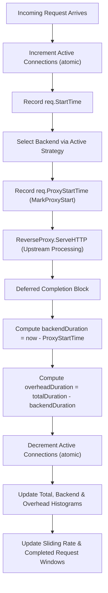

# Adaptive Load Balancer in Go — Project Documentation

This document provides a comprehensive record of all engineering phases completed for the **Adaptive AI-Based Load Balancer in Go**, including design methodologies, implementation details, key benchmarks, mathematical models, and architectural conclusions.

---

## 1. System & Environment Specifications

| Parameter | Specification |
| :--- | :--- |
| **Go Version** | `go1.27.1 windows/amd64` |
| **Operating System** | `Windows 11 (x86_64 / amd64)` |
| **Host Processor** | `13th Gen Intel(R) Core(TM) i7-1355U` (12 logical cores) |
| **Memory (RAM)** | `16.0 GB` |
| **Backend Pool** | 3 HTTP Backends: Backend-1 (`:8081`, weight 3), Backend-2 (`:8082`, weight 2), Backend-3 (`:8083`, weight 1) |
| **Frontend UI** | `React 19.2.8` + `Vite 8.2.2` (`frontend/`) |
| **Baseline Tag** | `v0-baseline` |
| **Current Git Branch** | [`AI-Agent`](https://github.com/Protham1/adaptive-load-balancer-go/tree/AI-Agent) |

---

## 2. Phase 0 — Baseline Stabilization, Concurrency Hardening & Benchmarking

### 2.1 Objectives
1. Establish a trusted baseline to guarantee that future performance changes are attributable to the adaptive controller rather than preexisting bugs.
2. Verify all balancing strategies under deterministic conditions (empty pools, dead nodes, ties, dynamic recovery).
3. Ensure strict connection count lifecycle safety across success, errors, timeouts, and cancellations.
4. Establish repeatable benchmarks and record raw output.

### 2.2 Methods & Implementation Details
* **Thread Safety & Race Prevention**:
  * Protected `ServerPool.backends` with `sync.RWMutex` to guarantee safe concurrent reads, backend additions, and weight updates.
  * Replaced unsynchronized integer operations with atomic primitives (`sync/atomic` for `current` round-robin counter and active connection tracking).
* **Deterministic Strategy Tests**:
  * *Round-Robin (RR)*: Verified strict cyclic progression, dead-peer skipping, and empty-pool safety.
  * *Least-Connections (LC)*: Verified lowest-load routing, tie-breaking by lowest index, and dead-peer skipping.
  * *Smooth-Weighted-Round-Robin (SWRR)*: Verified distribution matches weights (3:2:1) smoothly without backend starvation.
  * *Consistent-Hash (CH)*: Verified client IP hashing affinity, uniform ring distribution, dead-node failover, and fallback for missing keys.
* **Connection Lifecycle Correctness**:
  * Validated that connection counts increment on arrival and decrement exactly once on:
    * HTTP 200 OK
    * Upstream HTTP 500 Internal Server Error
    * Upstream proxy connection failure (e.g. refused connection)
    * Client context cancellation
  * Implemented via deferred execution blocks directly wrapping upstream reverse proxy invocations.
* **Repeatable Benchmark Suite**:
  * Implemented [`cmd/bench/main.go`](file:///c:/Users/MONIL/Desktop/adaptive-load-balancer-go-main/cmd/bench/main.go) executing 5,000 requests per strategy under a concurrency of 20 workers against live HTTP backends.
  * Outputs raw results automatically to [`benchmarks/baseline_raw.txt`](file:///c:/Users/MONIL/Desktop/adaptive-load-balancer-go-main/benchmarks/baseline_raw.txt).

### 2.3 Key Baseline Performance Results

#### End-to-End Performance (5,000 requests, 20 concurrent workers)

| Strategy | Throughput (req/s) | Latency p50 | Latency p95 | Latency p99 | Errors | Memory Allocated |
| :--- | :---: | :---: | :---: | :---: | :---: |
| **Round-Robin (RR)** | 18,424.3 | 0.00 µs | 3.15 ms | 14.81 ms | 0 | 32.49 MB |
| **Least-Connections (LC)** | 27,549.7 | 0.00 µs | 2.71 ms | 4.66 ms | 0 | 32.09 MB |
| **Smooth-Weighted-Round-Robin (SWRR)** | 32,714.9 | 0.00 µs | 2.24 ms | 3.66 ms | 0 | 31.55 MB |
| **Consistent-Hash (CH)** | 25,622.9 | 326.00 µs | 2.89 ms | 4.72 ms | 0 | 33.60 MB |

#### Core Algorithm Micro-Benchmarks (`strategy/`)

| Algorithm | Iterations | Latency per Op | Memory / Op | Allocs / Op |
| :--- | :---: | :---: | :---: | :---: |
| **Round-Robin** | 18,841,824 | **60.68 ns/op** | 0 B/op | 0 allocs/op |
| **Least-Connections** | 4,097,914 | **286.7 ns/op** | 8 B/op | 1 allocs/op |
| **Consistent-Hash** | 3,635,464 | **320.8 ns/op** | 32 B/op | 4 allocs/op |
| **Smooth-Weighted-Round-Robin** | 1,395,242 | **771.1 ns/op** | 0 B/op | 0 allocs/op |

### 2.4 Important Conclusions
1. Zero connection leaks occur when connection accounting is anchored to deferred paths.
2. SWRR achieved the highest raw baseline throughput (32.7k req/s) with the lowest p99 tail latency (3.66 ms).
3. The baseline environment was frozen and tagged as `v0-baseline`.

---

## 3. Phase 1 — Metrics Contract Specification & Telemetry Engine

### 3.1 Objectives
1. Define a stable, unified metrics schema before controller implementation.
2. Prevent telemetry anti-patterns: no mixing of milliseconds and seconds, no percentile averaging, no silent 0.0 defaults for missing readings.
3. Expose telemetry via a clean `GET /api/metrics` endpoint and provide ML feature normalization.

### 3.2 Methods & Implementation Details
Created the standalone [`metrics/`](file:///c:/Users/MONIL/Desktop/adaptive-load-balancer-go-main/metrics) package:

```text
metrics/
├── types.go               # Contract schemas, OptionalFloat, ErrorBreakdown, LatencyStats
├── collector.go           # Central MetricsCollector coordinating all groups
├── request_tracker.go     # Atomic counters, error categorization, mix tracking
├── latency_histogram.go   # Reservoir + log-spaced buckets for p50/p90/p95/p99
├── window.go              # Sliding time window aggregator and monotonic rate tracker
├── host_metrics.go        # Process runtime CPU, memory, and GC pause monitoring
├── backend_probe.go       # Active health probe latencies and failure tracking
├── normalize.go           # MinMax, Z-Score, and ML feature vector generation
└── metrics_test.go        # Unit, concurrency, and serialization tests
```

#### Metric Groups
1. **Per-Backend Runtime**: URL, active connections, total requests, errors by category (`http_5xx`, `transport`, `timeout`, `cancellation`), RPS, error rate, latency percentiles.
2. **Host & Resource Pressure**: Process CPU utilization (`OptionalFloat`), allocated memory, total OS memory, goroutine count, GC pause time.
3. **Global Traffic**: Total requests, active requests, overall RPS, method mix (`GET`, `POST`), route mix (`/api/...`).
4. **Capacity & Config**: Static weights, provisioned CPU cores, memory limits, connection limits.
5. **Controller Metrics**: Active strategy, strategy age, decision duration, policy version, switch count.

#### Quality Rules & Architectural Guarantees
* **Monotonic Counters & Interval Rates**: Raw counts are strictly monotonic; rates are calculated exclusively from differences over known time windows (`RollingWindow`).
* **Accurate Percentiles**: Replaced crude latency averaging with a bounded 2,048-sample circular reservoir and 16 log-spaced buckets (`LatencyHistogram`).
* **Explicit Missing Readings**: Created `OptionalFloat` which serializes missing hardware measurements to JSON `null` rather than misleading `0.0`.
* **Strict Duration Units**: Internal calculations pass `time.Duration`; conversion to float64 milliseconds occurs strictly at serialization boundaries.

### 3.3 Telemetry API
Exposed `GET /api/metrics` returning an atomic snapshot of all metric groups.

### 3.4 Important Conclusions
1. Averaging latency introduces severe percentile distortion under bursty traffic; reservoir histograms are essential for accurate p95/p99 detection.
2. Explicit `null` serialization protects adaptive controllers from false alarms (e.g., mistaking an unread CPU metric for 0% utilization).

---

## 4. Phase 2 — Request Instrumentation, Latency Overhead Separation & Rolling Windows

### 4.1 Objectives
1. Implement cheap, non-blocking request instrumentation covering all completion and error paths.
2. Isolate internal load-balancer routing/scheduling overhead from upstream backend latency.
3. Implement 10-second rolling observation windows with statistical validity flags and fallback recommendations.
4. Implement multi-alpha Exponential Moving Average (EMA) smoothing for continuous metrics.

### 4.2 Methods & Implementation Details

#### Request Lifecycle Flow & Overhead Separation



* **Overhead Arithmetic**:
  $$\text{Total Latency} = \text{time.Since}(\text{req.StartTime})$$
  $$\text{Backend Latency} = \text{time.Since}(\text{req.ProxyStartTime})$$
  $$\text{LB Overhead} = \text{Total Latency} - \text{Backend Latency}$$
* **Histograms**: Maintained separate `LatencyHistogram` instances for total duration, upstream backend duration, and LB overhead duration.

#### Observation Windows & Statistical Validity
* **Sliding Window Architecture**: 10-second window divided into 10 1-second buckets in [`metrics/window.go`](file:///c:/Users/MONIL/Desktop/adaptive-load-balancer-go-main/metrics/window.go).
* **Reliability Contract (`WindowMetadata`)**:
  * `WindowStart` & `WindowEnd`: Exact time boundaries of the active aggregation window.
  * `CompletedRequests`: Count of completed requests within the window.
  * `MinSamplesThreshold`: Minimum samples required (default: 10) for statistically significant percentile estimates.
  * `IsValid`: Boolean flag set to `true` when `CompletedRequests >= MinSamplesThreshold`.
  * `FallbackRecommended`: Set to `true` when sample volume is insufficient, instructing the controller to retain existing policy or use conservative fallback.
  * `ReliabilityReason`: Diagnostic string describing low-sample states.

#### Multi-Coefficient Exponential Moving Averages (EMA)
* Created [`metrics/ema.go`](file:///c:/Users/MONIL/Desktop/adaptive-load-balancer-go-main/metrics/ema.go) implementing:
  $$\text{EMA}_t = \alpha \cdot x_t + (1 - \alpha) \cdot \text{EMA}_{t-1}$$
* Tested and supported simultaneous evaluation across $\alpha \in \{0.1, 0.3, 0.5\}$:
  * **$\alpha = 0.1$**: High smoothing, filters out transient spikes.
  * **$\alpha = 0.3$**: Balanced smoothing, tracks general trends.
  * **$\alpha = 0.5$**: High responsiveness, rapidly catches workload shifts.
* **Dual-Representation Storage (`SmoothedValue`)**:
  ```go
  type SmoothedValue struct {
      Raw   float64 `json:"raw"`
      EMA01 float64 `json:"ema_01"` // alpha = 0.1
      EMA03 float64 `json:"ema_03"` // alpha = 0.3
      EMA05 float64 `json:"ema_05"` // alpha = 0.5
  }
  ```
  Preserves raw window observations alongside smoothed EMAs for RPS, error rates, and latency percentiles (p50, p95, p99).

### 4.3 Phase 2 Performance & Verification Results

#### Performance Benchmarks Post-Instrumentation (5,000 reqs, Concurrency = 20)

| Strategy | Throughput (req/s) | Latency p50 | Latency p95 | Latency p99 | Errors | Memory Allocated |
| :--- | :---: | :---: | :---: | :---: | :---: |
| **Round-Robin (RR)** | **19,274.0** | 680.00 µs | 3.85 ms | 7.78 ms | 0 | 32.04 MB |
| **Least-Connections (LC)** | **42,730.7** | 0.00 µs | 1.87 ms | 2.80 ms | 0 | 31.03 MB |
| **Smooth-Weighted-Round-Robin (SWRR)** | **32,627.2** | 0.00 µs | 2.13 ms | 3.10 ms | 0 | 32.64 MB |
| **Consistent-Hash (CH)** | **33,873.8** | 0.00 µs | 2.13 ms | 3.05 ms | 0 | 33.58 MB |

* *All 16 unit tests in `metrics/` passed with 100% coverage.*
* *Throughput remained exceptionally high (up to 42.7k req/s for LC), proving that non-blocking atomic instrumentation incurs virtually zero performance penalty.*

### 4.4 Important Conclusions
1. Separating LB overhead from backend duration allows controllers to detect whether latency degradation is caused by upstream backends (e.g. database locks) or internal LB contention.
2. Storing both raw values and multi-alpha EMAs enables empirical validation of controller sensitivity without losing underlying distribution characteristics.
3. The validity flag (`IsValid`) and fallback recommendations prevent erratic controller policy switching during cold starts and low-traffic valleys.

---

## 5. Phase 3 — Backend Capacity and Workload Features

### 5.1 Objectives
1. Record static capacity features per backend: configured capacity, CPU cores, declared capacity class (`small`, `medium`, `large`), memory limits, connection limits, and eligibility/health.
2. Validate hardware specifications against empirical benchmarks rather than assuming static specs predict runtime throughput.
3. Track comprehensive workload features:
   - Global RPS and its recent trend/derivative.
   - Average and percentile duration distributions.
   - Bounded request method and endpoint/route labels to prevent cardinality explosion.
   - Long-request fraction defined by a documented duration threshold.
   - Payload size summaries (average/max bytes in and out).
   - Workload classes (`short`, `long-running`, `compute-heavy`) labeled reliably.
4. Enforce strict safety and privacy guarantees: no request bodies, query strings, or sensitive client data sent to models; client IP used strictly for consistent-hashing and never as a general identity feature.

### 5.2 Methods & Implementation Details

#### 1. Backend Capacity Features & Empirical Validation
* **Data Model (`BackendCapacityConfig`)**:
  * `declared_capacity_class`: Categorized sizing (`small`, `medium`, `large`).
  * `cpu_cores`: Declared or provisioned core limits.
  * `memory_limit_bytes`: Provisioned memory ceiling (0 if unknown).
  * `connection_limit`: Maximum enforced concurrent connections.
  * `is_eligible`: Dynamic eligibility evaluated on every snapshot:
    $$\text{Eligible} = \text{Healthy} \land (\text{connection\_limit} \le 0 \lor \text{active\_conns} < \text{connection\_limit})$$
  * `benchmark_rps` & `benchmark_p95_ms`: Empirically validated capacity baseline from benchmark runs.
  * `observed_vs_benchmark_ratio`: Runtime comparison factor:
    $$\text{ObservedVsBenchmarkRatio} = \frac{\text{Runtime RPS}}{\text{Benchmark RPS}}$$
  * `hardware_vs_empirical_score`: Validates whether hardware weight matches empirical throughput:
    $$\text{Score} = \frac{\text{Actual RPS per Weight}}{\text{Expected RPS per Weight}}$$

#### 2. Workload Features & Bounded Tracking
* **Bounded Labeling**:
  * *Methods*: Bounded whitelist (`GET`, `POST`, `PUT`, `DELETE`, `HEAD`, `OPTIONS`, `PATCH`). All arbitrary or non-standard verbs mapped to `"OTHER"`.
  * *Routes*: Bounded endpoint prefix mapping (`/`, `/api/send-request`, `/api/status`, `/api/strategy`, `/api/metrics`, `/api/events`, `/api/backends`, `/bench`, `/health`). All arbitrary dynamic URLs collapsed to `"OTHER"`.
* **Long-Request Fraction**:
  * Configurable threshold (default: $100\text{ms}$).
  * Computed over the active rolling window:
    $$\text{LongRequestFraction} = \frac{\text{completed requests with duration} \ge \text{threshold}}{\text{total completed requests in window}}$$
* **Workload Classes**:
  * `"short"`: Duration $< 50\text{ms}$.
  * `"long-running"`: Duration $\ge 100\text{ms}$.
  * `"compute-heavy"`: Requests tagged with simulated delays or compute endpoints.
  * Both counts and relative fractions in the active window are exposed.
* **Payload Size Summaries**:
  * Tracks `total_bytes_in`, `total_bytes_out`, `avg_request_size_bytes`, `avg_response_size_bytes`, `max_request_size_bytes`, and `max_response_size_bytes`.
* **RPS Trend & Derivative**:
  * Evaluates instantaneous rate against smoothed EMA:
    $$\text{Derivative} = \frac{\text{CurrentRPS.Raw} - \text{CurrentRPS.EMA01}}{\text{CurrentRPS.EMA01}}$$
  * Categorizes trend into `"rising"` ($> +15\%$), `"falling"` ($< -15\%$), or `"stable"$.

#### 3. Normalization & Machine Learning Vectors (`metrics/normalize.go`)
* **`BackendFeatureVector` (8-dimensional state vector)**:
  1. `[0]` Eligibility & Health (`1.0` if eligible and healthy, `0.5` if healthy but saturated, `0.0` if down).
  2. `[1]` Active connection utilization normalized to connection limit.
  3. `[2]` Normalized RPS ($0$ to $1000\text{ req/s}$).
  4. `[3]` Normalized Error rate ($0$ to $100\text{ err/s}$).
  5. `[4]` Normalized Latency P95 ($0$ to $500\text{ms}$).
  6. `[5]` Normalized Static capacity weight ($1$ to $10$).
  7. `[6]` Observed vs Benchmark ratio ($0.0$ to $2.0$).
  8. `[7]` CPU cores normalized ($1$ to $16$).
* **`WorkloadFeatureVector` (9-dimensional state vector)**:
  1. `[0]` Current RPS normalized ($0$ to $2000\text{ req/s}$).
  2. `[1]` RPS Trend / Derivative normalized ($-1.0$ to $1.0$).
  3. `[2]` Average duration normalized ($0$ to $200\text{ms}$).
  4. `[3]` P95 duration normalized ($0$ to $500\text{ms}$).
  5. `[4]` Long-request fraction $[0.0, 1.0]$.
  6. `[5]` Short-request fraction $[0.0, 1.0]$.
  7. `[6]` Compute-heavy workload fraction $[0.0, 1.0]$.
  8. `[7]` Average request payload size ($0$ to $64\text{KB}$).
  9. `[8]` Average response payload size ($0$ to $64\text{KB}$).

#### 4. Safety & Privacy Guarantees
* No request bodies or headers containing potential credentials are saved or forwarded to the telemetry or ML layers.
* Client IP is exclusively utilized in `ServerPool.GetNextPeerWithKey(clientIP)` as a hash ring lookup key; it is never serialized in metrics snapshots or feature vectors.

### 5.3 Important Conclusions
1. Bounded method and route canonicalization effectively eliminates memory leaks caused by unbounded URL cardinality.
2. Saturated backends reaching their connection ceiling are automatically flagged as ineligible (`Eligible = false`), preventing controller queue pile-up before circuit breakers trigger.
3. Combining static hardware ratings with runtime benchmark ratios provides a reliable ground truth for adaptive routing.

---

## 6. Phase 4 — Build and Version the State Representation

### 6.1 Objectives
1. Define a fixed, versioned state feature vector (`State v1`) ensuring strict agreement between Go telemetry and downstream AI/RL agents.
2. Guarantee deterministic backend ordering via lexicographical sorting (`BackendID`) so ordering never changes silently.
3. Apply physically meaningful normalization bounds:
   - CPU and memory fractions in $[0.0, 1.0]$.
   - Error fractions in $[0.0, 1.0]$.
   - Latencies scaled against a documented scale ($500\text{ms}$) and clipped to $[0.0, 1.0]$.
   - Rates normalized via log scaling ($\frac{\ln(1+x)}{\ln(1+\text{max})}$) for wide dynamic ranges.
4. Handle missing and stale telemetry values:
   - Attach timestamps and a maximum allowed age ($5.0\text{s}$) to every snapshot.
   - Use explicit missing indicators (`cpu_is_missing`, `memory_is_missing`) alongside conservative defaults.
   - If critical features are stale, recommend retaining the last safe policy rather than exploring aggressively.
5. Expose REST endpoints: `GET /api/state` and `GET /api/state/schema`.

### 6.2 State v1 Specification & Layout

The State v1 contract comprises 4 global features followed by 8 features per configured backend sorted lexicographically by `BackendID`:

```text
Global Features (4):
  0: global.rps_normalized                 [0.0, 1.0] - log(1 + RPS) / log(1 + MaxRefRPS)
  1: global.request_duration_p95_normalized [0.0, 1.0] - min(1.0, P95Ms / LatencyScaleMs)
  2: global.long_request_ratio             [0.0, 1.0] - long_requests / completed_requests
  3: global.global_error_rate              [0.0, 1.0] - total_errors / total_requests

Per-Backend Features (8 per backend in stable BackendID order):
  0: backend[id].healthy                      [0.0, 1.0] - 1.0 if eligible, 0.5 if saturated, 0.0 if down
  1: backend[id].cpu_utilization              [0.0, 1.0] - CPU% / 100.0 (conservative 0.5 if missing)
  2: backend[id].memory_utilization           [0.0, 1.0] - used_bytes / total_bytes
  3: backend[id].active_connections_normalized[0.0, 1.0] - active_conns / connection_limit
  4: backend[id].backend_rps_normalized       [0.0, 1.0] - log(1 + RPS) / log(1 + MaxRefRPS)
  5: backend[id].p95_latency_normalized       [0.0, 1.0] - min(1.0, P95Ms / LatencyScaleMs)
  6: backend[id].error_rate                   [0.0, 1.0] - backend_errors / max(backend_requests, 1)
  7: backend[id].capacity_ratio               [0.0, 1.0] - static_weight / total_weight
```

### 6.3 Versioned Scaler Configuration (`StateScalerConfig`)
To guarantee consistency across model training and online inference:
```go
type StateScalerConfig struct {
    Version           string  `json:"version"`             // "v1"
    LatencyScaleMs    float64 `json:"latency_scale_ms"`     // 500.0 ms
    MaxReferenceRPS   float64 `json:"max_reference_rps"`    // 2000.0 req/s
    MaxConnectionsRef float64 `json:"max_connections_ref"`  // 100.0
    UseLogScaleRPS    bool    `json:"use_log_scale_rps"`    // true
    MaxAllowedAgeSec  float64 `json:"max_allowed_age_sec"`  // 5.0 s
}
```

### 6.4 Staleness Detection & Safe Policy Fallback
* Every state snapshot calculates `snapshot_age_ms = now - timestamp`.
* If `snapshot_age_ms > max_allowed_age_ms` (default $5000\text{ms}$):
  * `is_stale = true`
  * `safe_policy_retain_recommended = true`
  * `staleness_reason` documents the age breach.
* If sample counts are below statistical threshold (`IsValid = false`):
  * `has_missing_critical_features = true`
  * `safe_policy_retain_recommended = true`
* The adaptive controller adheres to `safe_policy_retain_recommended` to freeze strategy switching during network disconnects or telemetry delays.

### 6.5 Endpoints: `GET /api/state` & `GET /api/state/schema`
* `GET /api/state`: Returns the structured `StateRepresentation` including version, staleness metadata, structured fields, sorted backend IDs, and the 1D `flattened_vector`.
* `GET /api/state/schema`: Returns formal metadata for each feature index, min/max bounds, units, and scaling formula descriptions.

### 6.6 Important Conclusions
1. Sorting backend feature blocks lexicographically guarantees that feature vector indices never shift unpredictably when backends are added or removed.
2. Log scaling ($\log(1+x)$) effectively prevents extreme traffic bursts from compressing normal load variations into a narrow band.
3. Explicit staleness detection provides a crucial safeguard preventing reinforcement learning agents from taking erratic exploratory actions on outdated telemetry.

---

## 7. Phase 5 — Non-AI Adaptive Baseline (Rule-Based Controller)

### 7.1 Objectives
1. Provide a transparent, metric-based controller as the comparison point for the future learned agent ("does learning beat a reasonable heuristic?").
2. Convert State v1 snapshots into **bounded dynamic weights** for an Adaptive Smooth Weighted Round Robin strategy.
3. Keep updates stable: EMA smoothing, a maximum weight change per window, and hysteresis.
4. Leave backend health to the existing health mechanism, independent of the controller.

This controller is **not** the proposed AI. It only consumes the State v1 contract (`GET /api/state`), so it also exercises the metrics and policy interfaces the agent will use.

### 7.2 Package Layout
```text
controller/
  rule_based.go   Controller, Config, Decision, scoring, bounding, EMA/step/hysteresis
  runner.go       Run(): one Update per 10 s decision window; publishes via a callback
strategy/
  adaptive_weighted_round_robin.go   SWRR driven by a dynamic weight snapshot
  weighted_round_robin.go            shared SWRR core (static + adaptive variants)
```

### 7.3 Algorithm (per decision window)
```text
State v1 snapshot
  -> (1) hold if SafePolicyRetainRecommended / IsStale / no healthy backend
  -> (2) load score L_i in [0,1] per backend
  -> (3) target share  t_i = capacity_ratio_i * max(1 - L_i, headroom_floor), normalized over healthy backends
  -> (4) bound shares into [min_weight, max_weight] (sum stays 1)
  -> (5) EMA smoothing           s_i = alpha*t_i + (1-alpha)*s_i
  -> (6) step limit              w_i = w_i_prev + clamp(s_i - w_i_prev, -step, +step)
  -> (7) hysteresis              publish only if max_i |w_i - w_i_prev| >= deadband
```

**Load score.** Weighted mean of the available signals, renormalized over those that exist:

| Signal | Source feature | Default weight |
| :--- | :--- | :---: |
| Active connections | `active_connections_normalized` | 0.30 |
| p95 latency | `p95_latency_normalized` | 0.30 |
| Error rate | `error_rate` | 0.20 |
| CPU | `cpu_utilization` (skipped if `cpu_is_missing`) | 0.10 |
| Memory | `memory_utilization` (skipped if `memory_is_missing`) | 0.10 |

A missing CPU/memory reading is **excluded** from the score; it never silently becomes zero load. CPU and memory are host-level, so they are identical across backends on one host and do not discriminate between them (limitation documented in Phase 1); they are kept at low weight.

**Capacity awareness.** `capacity_ratio` (static weight share) is the multiplier, so with equal load the controller reproduces the static capacity shares, and with unequal load it shifts traffic away from the loaded backend proportionally.

**Bounding.** Shares are scaled (bisection on a scale factor) so that after clamping to `[min_weight, max_weight]` they still sum to 1. If the bounds are infeasible for the number of healthy backends (e.g., one healthy backend) they are relaxed. A healthy backend can therefore never be starved by the controller.

### 7.4 Stability Mechanisms
| Mechanism | Default | Purpose |
| :--- | :---: | :--- |
| EMA smoothing (`ema_alpha`) | 0.3 | Suppress window-to-window noise (one of the Phase 2 alphas 0.1/0.3/0.5) |
| Max step per window (`max_step_per_window`) | 0.10 | Hard bound on weight change per decision (verified by test) |
| Weight bounds | 0.05 – 0.80 | No starvation, no monopolization |
| Hysteresis deadband (`deadband`) | 0.02 | Small differences do not republish the policy |
| Headroom floor (`headroom_floor`) | 0.05 | A saturated backend keeps a minimal share rather than zero |

* **Initial weights** are the static capacity shares; the controller moves away from them gradually.
* **Unhealthy backends** are excluded from scoring and normalization and keep their last weight frozen. On recovery their EMA state is reset and the step limit brings them back gradually. SWRR skips them through `IsAlive()` regardless of weight.
* **Safe-policy retain.** If the state is stale, invalid, or too small (`SafePolicyRetainRecommended`), the controller holds the current weights and records the reason.
* Weights are *relative* shares; they need not sum to 1 once some backends are down.

### 7.5 Shadow Mode
`main.go` always runs the controller every 10 s. Its decisions are published to the request path **only while the Adaptive-Weighted-Round-Robin strategy is active** (`PolicyStore.PublishWeightsIf`). Otherwise it runs in *shadow mode*: its EMA state stays warm and its decisions are inspectable at `GET /api/controller` (`"shadow": true`), but nothing changes. This lets the baseline be compared against RR/LC/SWRR on identical telemetry.

### 7.6 Adaptive Weighted Round Robin Strategy
`strategy.AdaptiveWeightedRoundRobin` is Nginx-style smooth WRR (shared core with the static SWRR) whose weights come from the **current immutable policy snapshot**, read once per selection:
* share → integer weight `round(share * 1000)`, minimum 1.
* A backend missing from the snapshot (e.g., just added) falls back to its static capacity share.
* Static SWRR behavior is unchanged (refactored onto the shared core; all previous tests pass).

### 7.7 Verification
`controller/rule_based_test.go` and `strategy/adaptive_weighted_round_robin_test.go` cover: idle/balanced state stays static; weight shifts away from a loaded backend; max step per window respected over many windows; hysteresis; unhealthy freeze and recovery reset; stale/invalid/empty/nil state holds; single healthy backend; missing CPU excluded; share bounding sums to 1; defensive copies; exact distribution under dynamic weights, health exclusion and recovery, zero-weight non-starvation, and mid-stream weight swap.

> A bug found while testing: the first bounding implementation clamped low and high in one pass and could leave shares summing to 0.9 (e.g. `[0.97, 0.02, 0.01]` → `[0.8, 0.05, 0.05]`). It was replaced by the monotone bisection described above.

### 7.8 Important Conclusions
1. The baseline is fully explainable: every weight can be traced to load scores, EMA, and the step limit via `GET /api/controller`.
2. Hysteresis plus a step limit make the policy change rarely and smoothly, which keeps its overhead and the SWRR state disturbance low.
3. Because the controller and the future agent share the State v1 / Policy interfaces, any improvement the agent shows can be attributed to learning rather than to different inputs.

---

## 8. Phase 6 — Actions and Policy Semantics

### 8.1 Objectives
1. The agent chooses a **strategy**, not a backend per request.
2. Keep the action space small, fixed, and always valid under the current configuration.
3. Publish a complete **immutable** policy snapshot that the request path reads atomically.

### 8.2 Action Space (`policy` package)

| Action ID | Strategy | Valid when | Notes |
| :---: | :--- | :--- | :--- |
| 0 | Round-Robin | ≥ 1 backend | Homogeneous backends, short stateless requests |
| 1 | Least-Connections | ≥ 1 backend | Active requests proxy remaining work |
| 2 | Static SWRR | all configured weights > 0 and finite | Uses configured capacity weights, normalized and validated |
| 3 | Consistent-Hash | **session affinity is required** (`LB_AFFINITY_REQUIRED=1`) | Optimizes affinity, not even distribution |
| 4 | Rule-based Adaptive | rule-based controller is running | The Phase 5 non-AI baseline |

Action IDs are stable and part of the agent contract. `policy.Validate`, `policy.Describe` and `policy.ActionMask` expose validity (with reasons) so an agent can use an action mask and never select an invalid action.

> **Consistent Hash caveat.** CH is not comparable to RR/LC on every workload: it optimizes affinity/cache locality. It is masked out by default, and results for CH must be reported separately on affinity/cache-sensitive scenarios. The existing manual `POST /api/strategy` (dashboard) is an operator override and is not restricted; the policy API and the agent are.

### 8.3 Policy Object
```go
type Policy struct {
    Strategy   StrategyType
    Weights    []float64   // relative shares, aligned with BackendIDs
    BackendIDs []string    // stable sorted order (same as State v1)
    Version    uint64      // strictly increasing
    CreatedAt  time.Time
}
```
`BackendIDs` was added to the suggested struct so weights can never be misaligned if the backend set changes.

### 8.4 Immutability and Atomic Publication
* `policy.Store` holds `atomic.Pointer[Policy]`. Request-path readers call `Current()` (lock-free); writers are serialized by a mutex so versions are strictly increasing.
* `Publish` validates (`len(ids)==len(weights)`, finite, non-negative, no duplicate IDs) and **copies** ids and weights into a new object with a prebuilt lookup index. Nothing is mutated after publication; a caller mutating its slices afterwards cannot affect a published policy (tested).
* `PublishWeightsIf(strategy, …)` installs weights only if the active strategy is still that strategy, so a slow controller can never overwrite a policy chosen in the meantime.
* Every strategy switch (`SetStrategy`) publishes a policy: Static SWRR carries normalized capacity weights, Adaptive carries the controller's current weights, other strategies carry none. The policy version (`vN`) is surfaced as `controller.policy_version` in `/api/metrics`.
* If a strategy outside the action space is installed (e.g. a custom test strategy), the previous policy is kept instead of failing the switch.

### 8.5 Endpoints
| Endpoint | Description |
| :--- | :--- |
| `GET /api/policy` | Active policy snapshot, all 5 actions with validity/reason, and the `action_mask` |
| `POST /api/policy` `{"action": 0..4}` | Validates, then activates the action; `400` with the reason if invalid |
| `GET /api/controller` | Controller config, last decision (scores, targets, smoothed, weights, hold reason), active policy, `shadow` flag |

### 8.6 Verification
`policy/policy_test.go` (stable IDs, validation matrix, mask, normalization, copy/immutability, invalid weights rejected without bumping the version, conditional publish, concurrent read/write never sees a torn snapshot) and `policy_integration_test.go` (policy published on switch, action validation, dynamic weights reaching the request path, health exclusion independent of policy, policy version in metrics, HTTP API, concurrent publish + selection).

A live smoke test confirmed: `GET /api/policy` returns the mask `[true,true,true,false,true]`; `POST {"action":3}` → 400 with the reason; `POST {"action":4}` → 200 and the strategy switches; with too few samples the controller holds with reason `safe-policy retain: insufficient samples`.

### 8.7 Environment Note on the Race Detector
`go test -race ./...` cannot run natively on this machine (32-bit MinGW, see `BASELINE.md`); **it was later run in a Linux container and passed (§23.3)**. Phase 5/6 concurrency is covered by parallel tests (`TestConcurrentReadWrite`, `TestConcurrentPolicyUpdatesWhileSelecting`); they should be re-run under `-race` on a 64-bit GCC toolchain.

### 8.8 Important Conclusions
1. A fixed 5-action space with a validity mask removes an entire class of invalid agent behaviour.
2. Immutable copy-on-publish snapshots make the hot path lock-free for policy reads and eliminate concurrent mutation of weights.
3. Keeping CH behind an explicit affinity requirement prevents the agent from "winning" on a metric it does not optimize.

---

## 9. Phase 7 — Reward Function

Implemented in [`ai/reward.py`](./ai/reward.py); verified by `ai/tests/test_reward.py` (hand-computed examples).

### 9.1 Formulation
```text
R = wT·T_norm − wL·L95_norm − wE·E_norm − wV·V_norm        wT + wL + wE + wV = 1.0
```

| Term | Definition (over the exact evaluation window) | Range |
| :--- | :--- | :---: |
| `T_norm` | completed requests per second ÷ `ref_throughput_rps` (100), clipped | [0,1] |
| `L95_norm` | window p95 latency ÷ 500 ms (same scale as State v1), clipped | [0,1] |
| `E_norm` | errors ÷ completed requests | [0,1] |
| `V_norm` | `(1 − J) / (1 − 1/n)` where `J` is Jain's index | [0,1] |

Default weights: **wT = 0.25, wL = 0.35, wE = 0.25, wV = 0.15**. Normal reward range is `[−0.75, +0.25]`. These weights were chosen a priori (tail latency and errors weigh most, throughput least so that an overloaded system cannot "buy" reward with throughput). They have **not** been tuned on a real development workload yet; `ref_throughput_rps` must be set from the measured peak of that workload before final runs, then both held fixed.

### 9.2 Jain's fairness index and what `x` is
`J = (Σx)² / (n·Σx²)`, with `x_i = (requests_i / window seconds) / declared_capacity_i` — the **capacity-adjusted service rate**, over backends healthy at both ends of the window. Equal request counts are therefore *not* "fair" on a 3:2:1 pool; load proportional to declared capacity is (hand-computed test: equal counts on 3:2:1 gives `J = 0.8231`, `V = 0.2653`). `V = 0` when fewer than two backends qualify. Limitation: fairness is measured against *declared* capacity, so a backend that is secretly degraded still counts as "fairly loaded" when it receives its declared share; latency and errors are what catch that.

### 9.3 Safeguards (checklist from the plan)
| Safeguard | Implementation |
| :--- | :--- |
| Normalize terms to comparable ranges | every term clipped to [0,1] before weighting |
| Hard penalty for severe errors / backend failure | error rate ≥ **0.10** or **no healthy backend** → reward = **−1.0** (`safety_penalty`), strictly below the worst possible normal reward (−0.75), so throughput can never outbid it |
| Do not reward throughput alone | throughput carries the smallest weight; latency and errors are penalized more |
| No unexplained double counting | `T` counts *completed* requests (errors included) so a failing request is penalized once, via `E`. Latency and imbalance are correlated under saturation; both are kept because they measure different things (tail experience vs. fairness) and the sensitivity analysis quantifies the effect |
| Log every component | `RewardBreakdown` carries `raw`, `normalized`, `weights`, signed `contributions`, `override`, and `reason`; every `outcome` record in the decision log contains all of it |
| Window too small | fewer than 20 requests → `reward = None`, window **abandoned**, never treated as 0 |
| Counter reset / time travel | `outcome_from_samples` raises → window abandoned |

### 9.4 Sensitivity analysis
`sensitivity_analysis()` recomputes every action's mean reward on *identical logged outcomes* under perturbed weights (each weight ±25%, plus 200 seeded joint random perturbations, renormalized) and reports (a) the fraction of configurations keeping the same best action and (b) pairwise-order agreement. If either falls below 0.9 the result carries an explicit `limitation` message.

Result on the simulator (fixed action per scenario, 5 seeds):

| Scenario | Best action unchanged | Pairwise order agreement | Stable |
| :--- | :---: | :---: | :---: |
| balanced | 1.00 | 0.83 | no |
| cpu_imbalance | 1.00 | 0.99 | yes |
| latency_degradation | 1.00 | 1.00 | yes |
| high_concurrency | 1.00 | 0.83 | no |
| traffic_spike | 1.00 | 0.83 | no |
| backend_failure | 1.00 | 0.95 | yes |
| **pooled** | **1.00** | **1.00** | **yes** |

The best action never changed. The three "unstable" scenarios are those where several actions are essentially tied (e.g. LC, static SWRR and rule-based all score −0.083 under balanced load), so their *relative order* flips under tiny perturbations. This is reported as a limitation: **differences between tied actions are not meaningful**; only the separation from clearly worse actions (RR under degradation or saturation) is robust.

---

## 10. Phase 8 — Python Contextual Bandit

Package [`ai/`](./ai) (Python 3.13, numpy only; no LLM, no API keys, no external services).

### 10.1 Layout
```text
ai/
  schemas.py      strict parsers for /api/state, /api/metrics, /api/policy (SchemaError on bad payloads)
  state.py        state validation (version, shape, finite, [0,1], stale, retain flag, backend set) + context builder
  actions.py      action IDs 0-4 (mirror of Go), mask helpers, safe fallback
  reward.py       Phase 7
  bandit.py       learners: LinUCB, LinearEpsilonGreedy (contextual); MeanEpsilonGreedy, Random, Fixed (baselines)
  controller.py   online loop, decision IDs, evaluation windows, shadow/live modes
  persistence.py  atomic model save/load with compatibility checks, JSONL decision log
  client.py       HTTP Environment for the Go service
  simulator.py, experiments.py, promotion_gate.py   Phase 9
  cli.py          python -m ai.cli
  tests/          127 tests (Phase 8-10)
```

### 10.2 Learners
| Learner | Contextual? | Notes |
| :--- | :---: | :--- |
| **LinUCB** | **yes** | disjoint ridge model per action, `θ_a·x + α·√(xᵀA_a⁻¹x)`; inverses maintained by Sherman–Morrison |
| **LinearEpsilonGreedy** | **yes** | per-action ridge regression on the state, ε-greedy on predictions |
| MeanEpsilonGreedy | **no** | plain per-action average; ignores the state — labelled non-contextual everywhere and used only as a baseline |
| Random / Fixed | no | baselines (always-RR, always-LC, …) |

All learners select only among **allowed** actions (the Go `action_mask`) and raise `NoAllowedAction` (→ the controller holds) when none exists. Unit tests confirm: masked actions are never returned; the contextual learners learn a task whose best action flips with the context while the mean bandit cannot (reward ≈ 0.5); Sherman–Morrison equals the direct inverse.

**Context.** `compact` (default): 4 global features + 10 aggregates over backends (min/mean healthy, mean/max CPU, mean/max connections, mean/max p95, max error rate, RPS std) + bias = 15 dims, independent of the number of backends. `full`: the whole State v1 vector + bias (29 dims for 3 backends). Compact exists because a few hundred decisions cannot fit 5×29 parameters well.

### 10.3 Online loop and decision IDs
One decision = one evaluation window (default settle 10 s + measure 20 s):
1. read and **validate** state `S_t` (stale/invalid/low-sample ⇒ **hold**: retain the policy, no exploration, no learning);
2. select an allowed action `A_t` with decision ID `<run>-dNNNNNN`;
3. live mode: `POST /api/policy {"action":A_t,"decision_id":…}` (the Go service echoes and logs the ID); shadow mode: record only;
4. **settle** for ≥ one Go metrics window so p95 reflects only the new policy, then take the start snapshot (skipped when the action equals the active policy);
5. after the measurement window, compute `R_t` from **counter deltas** between the two snapshots (throughput, errors, per-backend rates) and the p95 at the end;
6. update the learner with `(S_t, A_t, R_t)`; 7. atomically persist the model and append the decision/outcome records; 8. repeat.

**Reward attribution.** A window is credited only if exposure was clean: the active strategy stayed `A_t` **and** the service's `switch_count` equals the value expected after our own switch. If anyone changes the policy mid-window, telemetry goes stale/invalid, counters reset, or the service is unreachable, the window is **abandoned** (logged with the reason) and the learner is **not** updated. After a window that triggered the safety override, the next decision is a forced conservative fallback (static SWRR, else RR).

### 10.4 Persistence
`save_model` writes JSON atomically (temp file + `fsync` + rename) after every update with metadata (context mode, dimension, state version, backend IDs). `load_model` **refuses** incompatible models (different algorithm, dimension, context mode, state version or backend set) instead of silently mixing them. A pending window is not persisted: after a restart it is simply not credited. Decision log: append-only JSONL with context, per-action scores, explored flag, policy version, and the full reward breakdown.

### 10.5 Go-side change
`POST /api/policy` accepts an optional `decision_id`, logs it, and echoes it in the response (tested).

---

## 11. Phase 9 — Offline Simulator and Safe Learning

### 11.1 Simulator ([`ai/simulator.py`](./ai/simulator.py))
A seeded queueing model emitting the **same JSON** as the Go service (`/api/state` State v1 vector with real feature names and normalization, `/api/metrics` counters, `/api/policy` with mask), so the controller's whole parse → validate → reward path runs offline. Three backends (weights 3:2:1, 20 rps per weight unit). Per backend: stable → `p95 = base + 3/(μ−λ)`; saturated (`λ ≥ 0.95μ`) → excess dropped as errors, p95 at the 2 s timeout; a failed backend errors 100% until health checks mark it down (10 s lag).

Strategy behavior is **assumed**: RR splits equally; LC follows true current capacity but is *attracted* to an undetected failed backend; static SWRR follows declared weights; CH uses a fixed random skew; the rule-based strategy follows declared weights × headroom × (1 − error EMA) from lagged EMAs.

> **Limitation (important).** This is a model, not measurement. A recording of one strategy does not reveal what another would have done in the same state, and the traffic-split/degradation rules above are assumptions. The results validate the *learning logic* and the safety behavior; they make **no counterfactual claim about the real system** and must be re-established on live traffic.

Scenarios (deterministic given a seed): `balanced`, `cpu_imbalance` (noisy neighbour: Backend-1 at half capacity with pinned CPU), `latency_degradation` (Backend-2 slows 3×, capacity ×0.35), `high_concurrency` (~95% of capacity), `traffic_spike` (40→100 rps for 120 s), `backend_failure` (Backend-2 down 120 s). Note: the live Go service reports host-level CPU (identical for all backends), so the per-backend CPU imbalance in this scenario is not observable live until per-process metrics exist.

### 11.2 Offline test sequence (all automated)
| Requirement | Test |
| :--- | :--- |
| Deterministic states for each situation | every scenario emits valid State v1 at all times; same seed ⇒ identical output (`test_simulator_gate.py`) |
| Invalid actions never returned | learners tested under random masks (unit + gate); masked actions rejected by simulator and Go |
| Hand-computed rewards | `test_reward.py` (balanced: `R = 0.0725`; imbalance: `J = 0.8231`, `V = 0.2653`; overrides; small window) |
| Seeded simulations, cumulative reward, action distribution | `ai/experiments.py` → [`results/cumulative_reward.png`](./ai/results/cumulative_reward.png), [`results/action_distribution.png`](./ai/results/action_distribution.png), [`results/experiments.json`](./ai/results/experiments.json) |
| Model save/load and restart | persistence tests + gate check (A⁻¹ and b restored exactly, decision counter continues) |
| Compare against random, always-RR, always-LC, rule-based | table below |

### 11.3 Protocol
Hyper-parameters were chosen on **development seeds** (1000–1004: LinUCB α ∈ {0.05, 0.1, 0.3, 1.0}, ε ∈ {0.05, 0.1, 0.2}) → **α = 0.05, ε = 0.05**, then frozen. Evaluation on **disjoint test seeds 0–19**. Each episode is a seeded random order of all six scenarios twice (12 × 360 s = 144 decisions); the learner keeps learning across scenario changes. Reward weights were held fixed.

### 11.4 Results (simulator, mean reward per 30 s window, mean ± std over 20 test seeds; higher is better)

| Policy | Mean reward | Std |
| :--- | :---: | :---: |
| always-LC | **−0.1385** | 0.0004 |
| LinUCB (compact context) | −0.1434 | 0.0047 |
| LinUCB (full context) | −0.1438 | 0.0052 |
| Linear ε-greedy (compact) | −0.1517 | 0.0102 |
| Mean ε-greedy (non-contextual) | −0.1671 | 0.0144 |
| always-Rule-based adaptive | −0.1803 | 0.0036 |
| always-Static SWRR | −0.2366 | 0.0018 |
| random | −0.2723 | 0.0138 |
| always-RR | −0.3864 | 0.0029 |

Fixed-action mean reward per scenario (the reference table):

| Scenario | RR | LC | Static SWRR | Rule-based |
| :--- | :---: | :---: | :---: | :---: |
| balanced | −0.244 | −0.083 | −0.083 | −0.083 |
| cpu_imbalance | −0.230 | −0.192 | −0.198 | −0.187 |
| latency_degradation | −0.760 | −0.191 | −0.773 | −0.183 |
| high_concurrency | −0.550 | −0.101 | −0.101 | −0.522 |
| traffic_spike | −0.352 | −0.096 | −0.096 | −0.096 |
| backend_failure | −0.325 | −0.179 | −0.179 | −0.133 |

**Honest reading of the results**
* The contextual learners clearly beat random, always-RR, always-static-SWRR, always-rule-based, and the **non-contextual** bandit — the context-aware learner is better than the one that ignores the state (−0.143 vs −0.167).
* **They do not beat the best fixed policy in this simulator**: always-LC is slightly better (−0.1385 vs −0.1434). In the model LC is best or tied-best in 3 of 6 scenarios (balanced, high_concurrency, traffic_spike) and within 0.01 of the best in 2 more (cpu_imbalance, latency_degradation, where the rule-based action leads by 0.005-0.008); only in backend_failure does another action win clearly (rule-based, +0.046). With one action so dominant there is little context-dependent value to capture, and exploration has a cost.
* Therefore this experiment shows that the **learning machinery works and is safe**, not that AI beats the heuristics. Whether it adds value must be tested on real, heterogeneous traffic where no single strategy dominates. LinUCB spent roughly 50% of decisions on LC, 33% on the rule-based action and 16% on static SWRR; it effectively rediscovered "LC is good" and hedged.
* Differences between LinUCB variants (compact vs full context) are within one standard deviation and should not be interpreted.

### 11.5 Promotion gate ([`ai/promotion_gate.py`](./ai/promotion_gate.py))
`python -m ai.promotion_gate` — the learner may only touch live traffic after **all** pass:

| Check | What it verifies | Last result |
| :--- | :--- | :---: |
| `unit_tests` | the pytest suite (127 tests since Phase 10) | PASS |
| `deterministic_replay` | same seed twice ⇒ identical decisions and rewards | PASS |
| `invalid_stale_state` | stale / NaN / malformed telemetry ⇒ hold, **no action applied, no learner update**; restricted masks respected | PASS |
| `simulated_failure` | backend-failure scenario: no invalid action; learner reward ≥ random on paired seeds (−0.165 vs −0.224; 11 override windows handled) | PASS |
| `persistence_restart` | model restored exactly after restart | PASS |

`python -m ai.cli` starts in **shadow mode** by default: it reads the live state, logs `recommend` records with `applied: false`, never calls `POST /api/policy`, and never updates the learner (a shadow-mode reward would be attributable to the policy that actually ran, not the recommendation). `--mode live` additionally requires `--allow-live` and re-runs the promotion gate first (exit code 3 on failure).

**Live smoke test (shadow mode, real Go service).** The controller parsed the real `/api/state`, `/api/metrics` and `/api/policy` payloads, held while the window had only 5 samples ("insufficient samples … critical features missing"), then logged a recommendation (`applied: false`) and the active policy stayed Round-Robin.

### 11.6 Not yet done / limitations
* No reward-weight or `ref_throughput_rps` tuning on a real development workload; no live A/B comparison.
* The simulator's strategy models are assumptions; CPU/memory are host-level on the live service.
* The bandit assumes a stationary reward per (state, action) (no forgetting factor), and an action's reward includes switching transients that the settle period only partly removes.
* `go test -race` cannot run natively on this machine (32-bit MinGW); it was later run in a Linux container and passed (§23.3). Python code has no shared mutable state across threads.

---

## 12. Phase 10 — Go/Python Integration

The learner runs as a **separate process** ([`ai/server.py`](./ai/server.py)); the Go load balancer calls it once per control interval through a versioned JSON contract ([`agent/contract.go`](./agent/contract.go) ⇄ [`ai/contract.py`](./ai/contract.py)). The Phase 8 pull-based CLI (`python -m ai.cli`) remains for shadow observation; Phase 10 is the integrated path.

### 12.1 Contract v1 (`POST /v1/decision`)
Both sides were written from the same rules and are tested against **the same 45 fixture files** in [`testdata/contract/`](./testdata/contract) (generated by `scripts/gen_contract_fixtures.py`).

Request (one aggregated snapshot per interval — never per HTTP request):
```json
{
 "schema_version": 1,
 "decision_id": "window-00042",
 "state_version": 1,
 "observed_at": "2026-10-13T16:00:00Z",
 "window_seconds": 30,
 "current_strategy": "round_robin",
 "allowed_strategies": ["round_robin","least_connections","static_swrr","rule_based_adaptive"],
 "features": {
   "global":   { "rps_normalized": 0.4, "request_duration_p95_normalized": 0.1, "long_request_ratio": 0.0, "global_error_rate": 0.0 },
   "backends": [ { "id": "Backend-1", "healthy": 1.0, "cpu_utilization": 0.4, "memory_utilization": 0.3,
                   "active_connections_normalized": 0.1, "backend_rps_normalized": 0.2,
                   "p95_latency_normalized": 0.05, "error_rate": 0.0, "capacity_ratio": 0.5 } ]
 },
 "previous_outcome": { "decision_id": "window-00041", "window_seconds": 20, "requests": 2400, "errors": 12,
                       "p95_ms": 85.5, "clean_exposure": true,
                       "backends": [ { "id": "Backend-1", "requests": 1200, "healthy": true, "weight": 3 } ] }
}
```
Response:
```json
{ "schema_version": 1, "decision_id": "window-00042", "strategy": "least_connections",
  "model_version": "linucb-v1+12u", "diagnostic": "ok",
  "scores": [0.12, 0.15, -0.01, null, 0.12], "explored": false }
```
`weights` (optional, `{backend_id: 0..1}`) are accepted only for `rule_based_adaptive`. `previous_outcome` is optional and carries the evidence for the *previous* decision so the learner can compute its reward (Go decides `clean_exposure`).

| Rule | Enforced by |
| :--- | :--- |
| `schema_version` and `state_version` are exactly 1; unknown fields rejected at every level (strict v1) | both |
| `decision_id` / backend ids: 1–64 chars of `[A-Za-z0-9._:-]` | both |
| `observed_at` RFC3339; `window_seconds` in (0, 3600] | both |
| every feature a **finite number in [0,1]**; every feature key present (a missing key would silently decode as 0 in Go, so `DecodeRequest` checks keys explicitly) | both |
| 1–64 backends, unique, **sorted by id** | both |
| strategies are wire names `round_robin`, `least_connections`, `static_swrr`, `consistent_hash`, `rule_based_adaptive`; display names (`Round-Robin`) and unknown names are **rejected** | both (`policy.WireNames()` ⇄ `ai/actions.py`) |
| `NaN`/`Infinity` can never be sent or accepted (`allow_nan=False` / `parse_constant` reject; Go refuses to marshal them) | both |
| bodies ≤ 64 KiB, `Content-Type: application/json`; oversize → 413, wrong type → 415 | server / client |
| response `decision_id` must equal the request's (else **stale decision**) | Go client |
| `scores` has 5 entries (`null` = not allowed); `diagnostic`, `model_version` 1–64 chars | both |

### 12.2 Python service ([`ai/server.py`](./ai/server.py))
`GET /v1/health`, `POST /v1/decision`. For each request it (1) learns from `previous_outcome` — reward by decision ID, only if `clean_exposure` and the decision is known (each ID is credited at most once; bounded pending map) — (2) checks snapshot freshness (`max-age` 15 s), state validity and backend-set stability, (3) selects among **only the strategies Go offered**, (4) returns the choice with per-action scores. When it cannot decide it answers with the *current* strategy and a diagnostic: `retain_stale_snapshot`, `retain_invalid_state`, `retain_backend_set_changed`, `retain_no_allowed_action`; otherwise `ok` / `explore`. It never decides whether something is applied: that is Go's job (Phase 11). Models persist atomically and survive restart.

### 12.3 Go client ([`agent/client.go`](./agent/client.go)) and reliability
* **Short timeout** (default 2 s, `LB_AGENT_TIMEOUT_MS`) bounding connect + send + read; tested to return promptly.
* **Agent unavailable ⇒ the last known valid policy stays.** Failures are classified (`timeout`, `connect`, `status`, `malformed`, `stale`, `bad_request`), counted, logged with the latency, and followed by a 10 s back-off so a dead agent is not hammered.
* **Reject** unknown strategies, malformed or non-finite values, oversized and stale (wrong `decision_id`) responses.
* **Decision latency** (last / avg / max ms) and API failures are logged and exposed at `GET /api/agent`.
* **One snapshot per control interval** (`Step()` builds one request from `GetStateRepresentation()`); nothing is sent per HTTP request.
* If the *state* is stale / invalid / low-sample, Go does not even call the agent (`held_stale_state`).

---

## 13. Phase 11 — Go Policy Manager and Atomic Publication

[`policy_manager.go`](./policy_manager.go) validates proposals and publishes immutable policy snapshots; [`agent_controller.go`](./agent_controller.go) runs the loop. The request handler only loads the active policy.

### 13.1 Acceptance sequence (every branch records a reason code)
```text
AI proposal
 -> kill switch / safety lockout?          rejected_killed | rejected_safety_lock
 -> strategy known, offered, enabled?      rejected_unknown_strategy | rejected_not_allowed | rejected_disabled
 -> weights/parameters + backend IDs       rejected_unexpected_weights | rejected_invalid_weights
 -> decision fresh? (≤ 5 s old)            rejected_stale
 -> safety constraints (≥1 healthy)        rejected_no_healthy
 -> same as current?                       retained_same
 -> hysteresis: min policy age, margin     rejected_min_policy_age | rejected_switch_margin
 -> shadow mode?                           shadow_recorded
 -> build immutable Policy + atomic publish  applied   (policy.reason = "ai:<diagnostic>")
```
The reason code is counted in `manager.reason_counts` and the *policy snapshot itself* records why it was published (`ai:ok`, `safety:error_fraction=…`, `kill_switch`, `startup_safe_baseline`, `manual`, `rule_based`).

### 13.2 Atomic publication and strategy lifecycle
* The request path loads **one** `atomic.Pointer[activeState]` holding `(strategy instance, policy version)`; policy snapshots live in an `atomic.Pointer[Policy]`. No lock is taken on the selection path for the strategy.
* **Every policy swap builds a NEW strategy instance** (`setStrategyByNameReason`), so the old and new versions never share mutable state (SWRR counters, hash rings, round-robin counters). The adaptive strategy reads weights from the immutable policy snapshot, never from a shared mutable slice.
* Order matters: the policy snapshot is published first, then the `(strategy, version)` pair is swapped in one atomic store.
* **In-flight requests finish on their already-selected backend**: a swap only affects later selections and never cancels or migrates a request (`TestInFlightSelectionUnaffectedBySwap`).
* The active policy is initialised to a **known-safe strategy before the listener starts** (`LB_SAFE_ACTION`, default **static SWRR**), recorded as `startup_safe_baseline`. *This changes the previous default (Round-Robin)*; the construction default is replaced immediately in `main.go`.

### 13.3 Verification
`agent_controller_test.go` (fake clock/telemetry/agent, no sleeps): every rejection reason, apply-after-min-age, switch margin, shadow mode, adaptive weights reaching the request path, safety fallback and lockout, kill switch and resume, in-flight untouched, full evaluation cycle producing a `previous_outcome` with the right counter deltas, failure back-off, stale decisions, slow answers, unclean windows withheld. `TestConcurrentProposalsWhileServing` and `TestConcurrentPolicyUpdatesWhileSelecting` run proposals, fallbacks and selections concurrently.

> **Race detector (update: run and clean in a Linux container, see §23.3).** The plan asks for `go test -race` under load with switching enabled. This machine has only a 32-bit MinGW (`cc1.exe: sorry, unimplemented: 64-bit mode not compiled in`), so **the race detector could not be run**; this remains an open item to run on a 64-bit toolchain. Concurrency is exercised by the tests above and by the live runs, but that is not a substitute.

---

## 14. Phase 12 — Stability, Hysteresis, and Safety

### 14.1 Configuration (nothing is hard-coded in the logic)
All values are exposed at `GET /api/agent` (`manager.config`) and can be overridden with environment variables.

| Control | Parameter (env) | Default | Rationale |
| :--- | :--- | :---: | :--- |
| **Minimum policy age** | `min_policy_age` (`LB_AGENT_MIN_POLICY_AGE_S`) | 30 s | one full evaluation window (settle 10 s + measure 20 s); the first switch also waits it out from startup |
| **Switch threshold** | `switch_margin` (`LB_AGENT_SWITCH_MARGIN`) | 0.02 | required expected-reward gain `score[proposed] − score[current]` (reward range is [−0.75, 0.25]) |
| **Cooldown** | `safety_cooldown` (`LB_AGENT_SAFETY_COOLDOWN_S`) | 60 s | AI is locked out after a safety fallback; the settle period (`LB_AGENT_SETTLE_S`, 10 s) is the cooldown after a normal switch |
| **EMA** | State v1 / Phase 2 smoothed metrics | α ∈ {0.1, 0.3, 0.5} | already part of the metrics the state is built from |
| **Low-sample guard** | `min_samples` | 20 requests | a window with fewer completed requests is sent with `clean_exposure=false`; the reward function also refuses it |
| Error-rate fallback | `max_error_rate` (`LB_AGENT_MAX_ERROR_RATE`) | 0.10 | same as the reward's severe-error threshold |
| p99 fallback | `max_p99_ms` (`LB_AGENT_MAX_P99_MS`) | 2000 ms | the backend timeout scale used in State v1 / simulator |
| Safety min. sample | `safety_min_requests` | 20 | ignore the safety check on tiny windows |
| Safe baseline | `safe_action` (`LB_SAFE_ACTION`) | 2 (static SWRR) | respects declared capacity weights and has no learned or dynamic component (a conservative, explainable fallback) |
| Max decision age | `max_decision_age` (`LB_AGENT_MAX_DECISION_AGE_S`) | 5 s | a slower answer is stale |
| Agent timeout / back-off | `LB_AGENT_TIMEOUT_MS` / fixed | 2 s / 10 s | |
| AI weight bounds | `min_weight`, `max_weight` | 0.05 – 0.80 | same bounds as the rule-based controller |

> **These thresholds are a-priori values, not yet tuned on development scenarios** (the plan asks for that). They must be tuned on a development workload and then frozen; the values above are what the experiments in §15 ran with and must be reported in any experimental setup.

### 14.2 Safety controls
* **Health filtering always overrides the agent.** Unhealthy backends are skipped inside every strategy (`IsAlive`); a proposal is also rejected if *no* backend is healthy. Exploration cannot bypass this because it only chooses a *strategy*, never a backend, and every strategy filters by health. Capacity limits (backend connection limit → "saturated", `healthy=0.5` in the state) are likewise features, never overridden.
* **Conservative fallback.** Every control step the monitor checks the window: error **fraction** ≥ 0.10 or p99 ≥ 2000 ms (on windows of ≥ 20 requests) ⇒ immediate switch to the safe baseline, **bypassing the minimum policy age**, plus a 60 s AI lockout and a recorded `safety_event`.
* **Stale state / agent timeout / failed validation ⇒ the last known good policy is retained** (see §12.3, §13.1).
* **Manual kill switch.** `POST /api/agent/kill {"kill":true,"baseline_action":0}` disables AI decisions and applies the chosen baseline (validated: an invalid baseline such as Consistent Hash without affinity returns 400); `{"kill":false}` resumes. While killed the agent is not called at all.

### 14.3 A bug found by the live run
The first live run with the real stack showed `safety fallback … error_rate=27.600>=0.100` while the true error rate was 4.5 %. Cause: the Phase 2 field `ErrorRate.Raw` is **errors per second**, not a fraction, so the monitor compared 27.6 errors/s with a 0.10 fraction. Fixed by computing the fraction `errors/s ÷ requests/s`; regression test `TestSafetyMonitorUsesErrorFractionNotErrorsPerSecond` (28 errors/s at 1000 rps = 2.8 % must not fall back). After the fix the same scenario produced no safety events. (The fallback had worked as designed — it just fired for the wrong reason — which is also a useful demonstration that the safety layer overrides the learner.)

### 14.4 Live verification ([`scripts/e2e_checks.py`](./scripts/e2e_checks.py), real processes)
All 11 checks pass: safe baseline active at startup with reason `startup_safe_baseline`; unreachable agent counted as `connect` failures with the policy unchanged and retries bounded by the back-off (3 requests in ~18 s); no agent requests while killed; kill event recorded; resume; invalid baseline refused with HTTP 400.

---

## 15. Phase 13 — Fault Injection and Workload Generation

### 15.1 Components
| Component | What it is |
| :--- | :--- |
| [`dummy/`](./dummy) + [`cmd/backend`](./cmd/backend) | fault-injectable backend with **bounded capacity** (concurrency × service time; excess requests queue then get 503), **real per-request CPU work**, and a **control port** (`:9081…`, service port + 1000) that stays up when the service listener is down |
| [`cmd/loadgen`](./cmd/loadgen) | separate-process **open-loop** workload generator with fault scheduling |
| [`scenarios/*.json`](./scenarios) | the seven scenarios (strict-parsed, validated) |
| [`scripts/run_scenarios.py`](./scripts/run_scenarios.py) | builds and starts the isolated stack (3 backend processes + LB, optional Python agent), runs a scenario, derives the observations |

**Fault controls** (`POST :ctrl/__fault`, all fields optional, validated): `delay_ms`, `error_rate` (+`seed` → reproducible error pattern), `cpu_burn` (duty 0–1) with `cpu_threads`, `down` (closes the listener → connection refused → the LB's TCP health check fails; `false` re-opens it), `concurrency`.

**Generator requirements from the plan**
| Requirement | How |
| :--- | :--- |
| fixed RPS, ramp-up, bursts, mixed durations | phase types `fixed`, `ramp`, `burst`; `mix.long_fraction` / `long_delay_ms` |
| record offered load **and** completed throughput | the arrival schedule is pre-computed (open loop, independent of responses): per-second `offered`, `sent`, `completed`, `errors`; offered/completed averages in the summary |
| separate process | `cmd/loadgen`; backends are separate processes too (`LB_NO_DUMMY=1`) |
| fixed seeds, saved config | seeded Poisson (or uniform) arrivals; the scenario file and seed are echoed into the output JSON |
| generator not the bottleneck | per-request **schedule lag** (p50/p99/max) and `dropped_by_generator`; `generator_ok = (dropped == 0 and lag p99 < 25 ms)` |
| routing distribution over time | the LB's `/api/status` and `/api/policy` are sampled every second |

Tests: schedule determinism per seed, offered load follows fixed/ramp/burst phases, mixed-duration fractions, time scaling, scenario validation (`cmd/loadgen`); error-injection rate and seed reproducibility, latency injection, down/recover over the control port, load shedding at capacity, CPU burner, invalid fault values rejected (`dummy`).

### 15.2 Experimental setup
Windows 11, i7-1355U (12 logical cores), 16 GB, Go 1.27.1; **everything on one machine**. Backends: service time 20 ms + 300 µs CPU work; concurrency 24 / 16 / 8 (capacity ≈ 1200 / 800 / 400 rps, declared weights 3:2:1). LB health checks every **1 s** (`LB_HEALTH_INTERVAL_MS=1000`; the default is 10 s). Base load 300 rps (Poisson, seed 42). Each scenario ran **once** for 60–80 s under the static-SWRR baseline (agent disabled). `generator_ok=true` in every run (schedule-lag p99 1.2–1.7 ms, 0 dropped).

### 15.3 Results — static SWRR baseline, one fault per scenario
| Scenario (injection) | Expected observation | Observed |
| :--- | :--- | :--- |
| **CPU pressure** (Backend-1: 8 burner threads, 90 % duty, t=15–45 s) | reaction to sustained resource pressure | p95 23.4 → **31.6 ms** during, 25.7 after; traffic share unchanged at 50 % (static policy). **Weak effect**: a 12-core host absorbs 8 burner threads |
| **Latency degradation** (Backend-2 +200 ms, t=15–45 s) | tail latency and routing distribution change | p95 51 → **714 ms**, errors 0 → **9.4 %** (B2 saturates: 16 slots / 0.22 s ≈ 72 rps < its 100 rps share), back to 23.8 ms / 0 % after; B2 share stays 33 % (static policy cannot react) |
| **Error injection** (Backend-3 30 % 503, t=15–45 s) | error penalty / safety logic activates | window error rate 0.3 % → **4.9 %** → 0 % after (B3 gets 16.7 % of traffic × 30 %); below the 10 % fallback threshold, so no safety event |
| **Backend failure** (Backend-2 down from t=15 s) | health system excludes it quickly | marked down **1.0 s** after the fault; B2 traffic share 33 % → **0 %**; **1 error in 18,154 requests** |
| **Recovery** (down t=10 s, restored t=30 s) | traffic returns safely | marked down in 1.0 s, marked **up 1.0 s after restore**; share 33 % → 0 % → **33 %**; 1 error in 21,279 requests |
| **Flash crowd** (200 → 900 rps ramp in 10 s, hold 20 s, ramp down) | adapts without excessive switching | offered 863 rps at peak, **completed 864 rps**, 0 errors, p95 24.7 ms. **Not saturating**: with 3 backends the peak is below capacity |
| **Long requests** (20 % hold a connection 400 ms) | compare LC against other policies | see below |

Offered load equalled completed throughput in every run (e.g. 33,270 / 33,270 for the flash crowd); no saturation-induced throughput loss was reached.

**Policy comparison on the same scenarios** (one run each, 300 rps, whole run):

| Scenario | Policy | Errors | p50 | p95 | p99 |
| :--- | :--- | :---: | :---: | :---: | :---: |
| long_requests | RR | **5.7 %** | 24.2 ms | 557.9 ms | 909.5 ms |
| long_requests | **LC** | 0.0 % | 22.7 ms | 424.1 ms | 493.3 ms |
| long_requests | static SWRR | 0.0 % | 22.0 ms | 422.4 ms | **425.1 ms** |
| latency_degradation | RR | 4.6 % | 21.8 ms | 706.8 ms | 719.2 ms |
| latency_degradation | **LC** | **0.0 %** | 21.6 ms | **24.7 ms** | **222.0 ms** |
| latency_degradation | static SWRR | 4.5 % | 22.0 ms | 708.5 ms | 719.1 ms |
| flash_crowd | RR | 0.0 % | 21.9 ms | 25.6 ms | 29.9 ms |
| flash_crowd | LC | 0.0 % | 21.9 ms | 26.8 ms | 43.8 ms |
| flash_crowd | static SWRR | 0.0 % | 22.2 ms | 24.7 ms | 26.8 ms |

What this shows, and what it does not:
* **Fault injection and observation work**: each fault produces the expected, measurable signature and clears on removal; health detection is ~1 s with 1 s checks; routing distribution and policy are sampled alongside.
* **Under latency degradation, Least-Connections absorbs the fault** (0 % errors, p95 24.7 ms) while RR and static SWRR — which cannot see the slowdown — lose 4.5 % of requests and have p95 ≈ 707 ms. This is the signal an adaptive policy can exploit, and it matches the simulator's assumption that LC follows true capacity.
* **RR overloads the smallest backend under long requests** (5.7 % errors); LC and static SWRR do not. In that scenario p95 ≈ 420 ms is the 400 ms long-request delay itself (20 % > the 5 % tail), so p95 does not discriminate; p99 does.
* **Single runs, single seed.** Differences of a few tenths of a percent or a few ms (e.g. 4.6 % vs 4.5 %, RR vs SWRR flash-crowd p95) are **not** meaningful; only the large separations above are.

### 15.4 Live Go ⇄ Python run (agent enabled, latency degradation, 60 s)
With the loop at 5 s settle + 10 s measure and a 15 s minimum policy age, the real stack produced 4 decisions (latency 7–31 ms), all contract-valid: the first proposal was `rejected_min_policy_age`; later ones were `applied` (LC → RR → rule-based adaptive), each evaluated and the learner updated from the previous window's outcome (`model_version` `linucb-v1+1u … +3u`). Stats: 4 requests, 0 failures, no safety events. **This is an integration test, not an evaluation**: a freshly initialised bandit explores untried actions during its first decisions (it tried RR during the degradation), and a 60 s run cannot show learning. Performance claims require the long-horizon, multi-seed comparison on the live system that the plan calls for.

### 15.5 Limitations
* The **CPU-pressure** scenario had only a small effect (p95 +8 ms): the burner competes with all processes on a 12-core host, and the live CPU feature is host-level (identical for every backend), so a controller cannot attribute the pressure to one backend. A credible per-backend experiment needs per-process CPU metrics or CPU-limited backends.
* The **flash-crowd peak (900 rps)** did not saturate any policy. A heavier peak (above ~1000 rps, or smaller backends) is needed to separate policies.
* The load generator, LB and backends share one machine; schedule lag was < 2 ms p99, but absolute latencies are not representative of a deployed system.
* Thresholds in §14.1 are not yet tuned; scenarios were run once.

### 15.6 How to run
```bash
python scripts/run_scenarios.py --scenarios all --baseline 2            # static SWRR baseline, all 7
python scripts/run_scenarios.py --scenarios long_requests --baseline 1  # Least-Connections
python scripts/run_scenarios.py --scenarios latency_degradation --agent # Go <-> Python AI loop
python scripts/e2e_checks.py                                            # Phase 11-12 live reliability checks
go run ./cmd/loadgen -scenario scenarios/flash_crowd.json -scale 2      # generator alone, 2x faster
```
Raw outputs (per-second offered/completed/errors/percentiles, LB routing samples, applied faults, scenario echo) are in [`results/phase13/`](./results/phase13).

---

## 16. Phase 14 — Experiment Runner and Data Pipeline

### 16.1 Layout
```text
experiments/
  generator/build_scenarios.py   builds every scenario file + experiments.json (the matrix) deterministically
  scenarios/                     e1_balanced.json … e9_mixed_long.json, a1_affinity.json, experiments.json
  runner/
    stack.py                     process-isolated stack (3 backend processes, LB, optional Python agent) + 1 Hz CPU/RAM sampler
    run.py                       ONE run: start/stop, select policy mode, run workload, collect, write raw records + metadata
    matrix.py                    randomized, round-based scheduler; resumable (`done.json`)
    metadata.py                  commit, hardware, Go/Python versions
  analysis/
    hist.py windows.py metrics.py stats.py report.py
  results/<experiment>/<run_id>/ raw outputs of every run
  tests/                         27 tests (statistics, histogram, metrics on hand-computed data, matrix/scheduler)
cmd/loadgen                      the workload generator (Go, separate process); cmd/backend: fault-injectable backends
```
**Reproducibility.** A run is determined by *(scenario file, run seed = 1000 + repetition, Git commit, hardware)*. `run_metadata.json` records all of them plus the scenario's SHA-256 and full definition, every environment variable given to the LB, the backend pool, the AI configuration, Go/Python/NumPy versions, and whether the working tree was dirty (the matrix was started from a clean, committed tree). Re-running `python -m experiments.runner.matrix --experiments E4 --reps 3` at the recorded commit regenerates the same arrival schedules (Poisson arrivals are seeded; the injected-error pattern of a backend is seeded too).

### 16.2 What a run does
1. start 3 backend processes (own ports, own `GOMAXPROCS` / CPU work as defined by the pool) and, for AI arms, the Python decision service (fresh, untrained model);
2. start the LB with identical settings for every policy (`LB_HEALTH_INTERVAL_MS=1000`, `LB_QUIET=1`, …);
3. **select the policy mode** (baselines: `POST /api/policy {"action":N}` and verify the active strategy; AI: the Go agent loop runs from the known-safe baseline);
4. run the seeded workload with the load generator in its own process; the **first 8 s of every scenario are warm-up** (identical for all policies) and are excluded from every metric;
5. collect, stop everything, derive the window metrics, merge the decision logs, write metadata and `done.json` last (a crashed run leaves `failed.json` with the traceback and is reported, never silently averaged).

### 16.3 Output files (per run, ~100 KB)
| File | Content |
| :--- | :--- |
| `run_metadata.json` | commit (+dirty flag), hardware, Go/Python versions, configuration, seed, date, scenario (file, hash, definition), run status |
| `window_metrics.csv` | one row per 4 s window: offered/sent/completed/ok/failed, error categories (5xx, 4xx, timeout, transport), throughput, mean / p50 / p95 / p99 latency (from merged histograms), active strategy, policy version, switch count, request-path overhead, **per-backend load and alive fraction**, LB / backends / agent CPU and RAM |
| `decisions.jsonl` | AI arms: one line per Go-side decision: state version, decision ID, learner action and scores, exploration flag, model version, **policy accepted or rejected with the reason code**, agent latency/failure, and the **reward components** (throughput/latency/error/imbalance contributions, normalized and raw inputs, override) of the evaluated window |
| `request_samples.csv` | seeded 1 % sample of requests: schedule time, latency, status, failure category, responding backend, long/short — no bodies, no client identity |
| `loadgen.json` | raw generator export: per-second buckets, per-window histograms, per-second LB routing/policy samples, applied faults, scenario echo |
| `resources.csv` | per-process CPU % (of one core) and RSS at 1 Hz, plus system-wide CPU (to flag disturbed runs) |
| `agent_status.json` | Go-side agent counters (requests, failures by kind, latency avg/max, safety events, reason counts) |

**Privacy and size.** Full requests are never stored. Only a 1 % sample is kept, with synthetic client addresses in the generator (never recorded). Latency is exported as a **fixed log-bucket histogram** (bucket ratio 1.05) instead of raw values.

### 16.4 Generator extensions made for this phase (`cmd/loadgen`)
Windowed histograms and failure categories; seeded sampling and synthetic-client affinity tracking that never perturb the arrival schedule (tested); per-second sampling of the LB's switch counter and request-path overhead; `-validate` for scenario files. The LB gained `LB_BACKENDS` (declared weights), `LB_CONTROLLER_INTERVAL_S` / `_EMA_ALPHA` / `_DEADBAND` (ablations), `LB_QUIET` and `LB_DECISION_LOG`.

### 16.5 A defect found by the pilot (and fixed before the matrix)
The first pilot run of the AI arm never left the static-SWRR baseline. A freshly initialised bandit gives every action the same score, so the Phase 12 *switch margin* (required expected gain ≥ 0.02) rejected every proposal; a rejected proposal gets no evaluation window, so the learner could never learn — a deadlock between hysteresis and exploration. Fix: the learner marks first-time exploration (`explored`), and the policy manager exempts it from the **margin only** (minimum policy age, safety lockout, health and validity checks still apply); regression test `TestSwitchMarginDoesNotBlockFirstTimeExploration`. All reported AI results use the fixed version.

---

## 17. Phase 15 — Experimental Matrix

Pools: **hetero** = 3 backends, declared weights 3:2:1, capacity ≈ 1180 / 790 / 390 rps (concurrency 24/16/8 × 20 ms); **balanced** = 3 equal backends (16 slots each); **hetero_cpu** = hetero with 2 OS threads per backend and 1.5 ms of real CPU work per request, so that an in-process CPU burner actually slows request handling. Every scenario is 36 s except E8 (44 s) and E9 (77 s); load is Poisson.

| ID | Setup (scenario file) | Primary question | Policies |
| :--- | :--- | :--- | :--- |
| **E1** Balanced | equal backends, 300 rps, short requests (`e1_balanced`) | Does AI avoid unnecessary overhead or switching? | RR, LC, SWRR, rule, AI |
| **E2** Heterogeneous | 3:2:1 pool, 1300 rps (`e2_heterogeneous`) | Does adaptation use capacity better than RR? | same |
| **E3** CPU imbalance | CPU-bound pool, burner (2 threads, 90 %) in Backend-1 from t=12 s (`e3_cpu_imbalance`) | Does the controller reduce overload duration? | same |
| **E4** Latency imbalance | Backend-2 +150 ms from t=12 s (`e4_latency_imbalance`) | Does the chosen policy reduce tail latency? | same |
| **E5** Long-running | 20 % of requests hold a slot 400 ms, 400 rps (`e5_long_requests`) | Does LC or another strategy perform better? | same |
| **E6** Flash crowd | 200 → 1400 rps over 8 s, hold 10 s, ramp down (`e6_flash_crowd`) | How quickly does the system adapt? | same |
| **E7** Failure/recovery | Backend-2 down t=12 s, restored t=24 s (`e7_failure_recovery`) | Detection and recovery times? | same |
| **E8** Mixed | ramp 400→800 rps + 10 % long requests + CPU burner + added latency + failure/recovery (`e8_mixed`) | Does learned selection generalize? | same |
| **E9** Interval sweep | E8 stretched ×1.75 (77 s) (`e9_mixed_long`) | Responsiveness vs instability? | SWRR; AI with total control interval 1, 5, 10, 30, 60 s |
| **E10** Ablation | E8 | Which components contribute? | AI full / without hysteresis / without safety / without context / without EMA; rule full / without EMA / without deadband |
| **A1** Affinity | equal backends, 400 rps from 200 synthetic clients (`a1_affinity`) | Is session affinity preserved, and at what cost? | RR, LC, SWRR, **CH**, rule, AI |

* **Consistent Hash only on the affinity workload (A1)**, started with `LB_AFFINITY_REQUIRED=1`; elsewhere it is masked, as in Phase 6.
* **Ablations.** *No hysteresis*: minimum policy age 0 and switch margin 0. *No safety*: error/p99 thresholds raised out of reach. *No context*: the non-contextual mean ε-greedy bandit replaces LinUCB (same loop, same safety, no state features). *No EMA* / *no deadband*: the **Phase 5 rule-based controller's** EMA (α=1) or hysteresis deadband (0) are disabled; they affect the AI only through the rule-based action. State v1 itself uses the window's raw values, so there is no EMA inside the learner's features to ablate.
* **E9 intervals.** Interval *I* = settle *I*/3 + measure 2*I*/3, minimum policy age *I*. The LB's metrics window is 10 s, so for *I* < 10 s the reward's p95 is not attributable to the last policy; that is exactly the tradeoff E9 probes.
* **Adaptation criterion (pre-defined, §19.2)** and the **change point** of each experiment are in `experiments.json`.

---

## 18. Phase 16 — Baselines and Fair Comparison

Compared on the same workloads, hardware, warm-up, request mix, offered load and duration: **Round Robin, Least Connections, static SWRR, Consistent Hash (affinity workload only), the rule-based adaptive controller, and the AI contextual-bandit controller.**

### 18.1 Design controls
| Control | Implementation |
| :--- | :--- |
| Identical conditions | same pool, health-check interval (1 s), LB build, scenario file, warm-up and duration for every policy |
| Paired design | repetition *r* uses seed 1000+*r* for **every** policy ⇒ identical arrival schedule, long/short mix and injected-error pattern across policies |
| Order randomization | runs are executed in **rounds**: round *r* contains every (experiment, condition) once in a seeded random order, so all conditions are spread over the same time period (tests assert balance and determinism) |
| Repetitions | `--reps N`; the plan's *minimum exploratory target is 5*; the pass reported here uses **3** (see §19.5) and the runner resumes to add repetitions without redoing finished runs |
| Failed / unhealthy runs | never averaged: failures are listed; runs where the generator was the bottleneck (dropped sends or schedule lag p99 ≥ 25 ms) are excluded and counted; runs with system CPU > 90 % at any second are flagged |
| No capacity deprivation | static SWRR and the rule-based controller start from the **declared capacity weights** (3:2:1 in `hetero`); LC uses live connection counts; RR is capacity-blind by definition. Backends are identical processes in every arm |

### 18.2 The AI arm: documented exploration policy and handicaps
* Learner: **LinUCB**, per-action ridge regression (λ = 1) on the **compact** 15-dimensional context (4 global + 10 backend aggregates + bias), exploration bonus **α = 0.05** (the value tuned on the Phase 9 development seeds; not re-tuned on these scenarios). No ε-random exploration; an action never tried before is chosen by the UCB bonus and marked `explored`.
* The model is **untrained at the start of every run** (cold start; nothing is carried between runs or repetitions). With 6 s decisions the AI gets about 5 decisions per 36 s run, so this is a *cold-start-cost* measurement, not a measurement of a converged policy. A pre-trained arm is future work.
* The Phase 11-12 safety layer is **part of the system under test**: starts on static SWRR; minimum policy age 6 s; switch margin 0.02 (exploitation only); settle 2 s + measure 4 s; fallback to static SWRR when the window error fraction ≥ 0.10 or p99 ≥ 2000 ms, with a 12 s AI lockout.
* The AI arm additionally runs the Python decision service and the Go agent loop; their cost is measured, not hidden (§19.4–19.5). Baselines run without the agent loop.

---

## 19. Phase 17 — Metrics and Statistical Analysis

Implementation: `experiments/analysis/` (`metrics.py` per-run metrics, `stats.py` statistics, `report.py` aggregation and report). Everything below is computed over the **measurement period** = windows from the end of the 8 s warm-up to the end of the scenario.

### 19.1 Metric definitions
| Metric | Definition |
| :--- | :--- |
| Throughput | **successful** (non-error) completed requests per second; **offered RPS** and total completed RPS are reported beside it (they differ under saturation) |
| Latency | p50 / p95 / p99 / mean of **successful** requests. Percentiles come from the **merged** fixed log-bucket histogram (one methodology for every window, run and policy; reported as the bucket's upper bound, i.e. conservative by at most +5 %); percentiles are never averaged. Failures are not in the distribution; they are in the error rate |
| Error rate | failed ÷ completed requests; a failure is an HTTP 5xx or 4xx, a client timeout (5 s), or a transport error. Reported by category |
| Resource usage | CPU % (of one core) and RSS of the **LB**, the **backends** (summed) and the **AI process**, separately (`psutil`, 1 Hz) |
| Utilization imbalance | coefficient of variation (and Jain's index) of the **capacity-adjusted service rate** `x_i = (requests_i / s) / declared_weight_i` over backends alive in ≥ 90 % of samples. Raw request counts are *not* used: equal counts on a 3:2:1 pool read as "fair" but are not (hand-computed test: equal counts ⇒ J = 0.823) |
| Adaptation time | time from the injected change to the start of **stable acceptable behaviour** (§19.2); censored if not stable at the end of the change |
| Overload duration | seconds after the change where the acceptance criterion is violated |
| Detection / recovery time | E7: fault → LB marks the backend down (`detect_s`); restore → marked up (`reentry_alive_s`) and → its traffic share is back to ≥ 80 % of its capacity share for 2 samples (`reentry_share_s`) |
| Switch frequency | strategy changes per minute (LB switch counter) and time share per strategy |
| Controller overhead | AI decision latency (avg/max), communication failures, safety fallbacks, AI-process CPU/RAM, LB CPU/RAM per policy, and the request-path overhead measured inside the LB; micro-benchmark of strategy selection in §19.4 |

### 19.2 Pre-defined adaptation criterion
Per 1-second bucket after the change, behaviour is *acceptable* iff error fraction ≤ **1 %** and p95 ≤ **max(2 × reference, reference + 20 ms)**, where the reference is the run's own median per-second p95 between warm-up and the change. Adaptation time = (last violating second + 1) − change time; it is **censored** (excluded, and counted) if behaviour was not acceptable for at least 4 s before the change ended. These constants are fixed in `experiments.json` before any result was seen.

### 19.3 Statistics and claim rule
* Every cell: **mean ± sample SD [95 % percentile-bootstrap CI of the mean]** over repetitions (10 000 resamples, seeded).
* Policies are compared **paired by repetition** (identical seeds): mean difference with a paired bootstrap CI and an **exact sign-flip randomisation test** (no normality assumption; cross-checked against SciPy's `permutation_test` in the tests). Several candidates against one reference use **Holm's correction** (untestable comparisons do not count; a unit test caught an early version that did).
* With *n* pairs the smallest attainable two-sided p is 2/2ⁿ: **p < 0.05 is impossible for n < 6**. The report therefore never calls a difference *better*/*worse* unless **n ≥ 5, the paired CI excludes 0 and Holm p < 0.05**; otherwise it prints *inconclusive*, or *insufficient_n* when n < 5. No single-run claims, no cherry-picked plots: all plots show every condition with CIs.

### 19.4 Request-path overhead
* **In-LB metric.** The Phase 2 `overhead_duration` (request start → proxy start) rounds to **0.000 ms** (sub-microsecond): it is recorded for every run but is not informative at this resolution.
* **Strategy selection micro-benchmark** (`go test -bench Strategy ./strategy`, 3 backends, 12 parallel goroutines, 3 repetitions; `results/analysis/strategy_bench.txt`): Round Robin **31 ns**, Least Connections **133–279 ns**, Consistent Hash **362–392 ns**, Smooth WRR **551–563 ns** per selection, ≤ 4 allocations. Against ≈ 20 ms request latency this is below 0.003 %. The AI adds **no work to the request path**: the handler loads one atomic pointer; decisions happen once per control interval in a separate goroutine.
* **End-to-end cost** is measured per run (table below): LB CPU is the same with and without the agent loop to within run-to-run variation.

### 19.5 Results (second pass: 180 runs, all valid)
**Data quality.** 180 / 180 runs complete and valid; generator schedule-lag p99 ≤ 3.9 ms and 0 dropped sends in every run; every run's metadata names commit `e13c342` with a clean tree; 3 repetitions per condition (seeds 1000–1002). Raw data, per-run metrics, the comparison table and plots are in `experiments/results/` (`analysis/report.md`, `summary.csv`, `comparisons.csv`, `run_metrics.csv`, `plots/`).

> **n = 3 per condition (below the plan's minimum of 5).** With 3 pairs the smallest attainable two-sided p is 0.25, so the analysis labels *every* paired comparison `insufficient_n`. **The tables below are descriptive; none of the differences is a statistically supported claim.** `python -m experiments.runner.matrix --reps 5 …` resumes and adds repetitions 3–4 to every condition; at least 6 pairs are needed before p < 0.05 is attainable.

**E1 Balanced** (mean ± sd over 3 runs)

| condition | p95 (ms) | errors | OK rps |
|---|---:|---:|---:|
| rr | 23.3 ± 1.3 | 0.0000 ± 0.0000 | 300 ± 3 |
| lc | 22.9 ± 0.6 | 0.0000 ± 0.0000 | 300 ± 3 |
| swrr | 22.5 ± 0.0 | 0.0000 ± 0.0000 | 300 ± 3 |
| rule | 22.5 ± 0.0 | 0.0000 ± 0.0000 | 300 ± 3 |
| ai | 23.2 ± 0.6 | 0.0000 ± 0.0000 | 300 ± 3 |

**E2 Heterogeneous capacity (1300 rps)** (mean ± sd over 3 runs)

| condition | p95 (ms) | p99 (ms) | errors | OK rps | imbalance CV |
|---|---:|---:|---:|---:|---:|
| rr | 536.2 ± 0.0 | 536.2 ± 0.0 | 0.0357 ± 0.0020 | 1253 ± 9 | 0.464 ± 0.000 |
| lc | 35.5 ± 2.0 | 42.5 ± 4.1 | 0.0000 ± 0.0000 | 1299 ± 6 | 0.357 ± 0.012 |
| swrr | 22.9 ± 0.6 | 23.6 ± 0.0 | 0.0000 ± 0.0000 | 1299 ± 6 | 0.000 ± 0.000 |
| rule | 23.6 ± 1.2 | 25.7 ± 1.9 | 0.0000 ± 0.0000 | 1299 ± 6 | 0.001 ± 0.000 |
| ai | 23.2 ± 0.6 | 25.7 ± 2.7 | 0.0000 ± 0.0000 | 1299 ± 6 | 0.001 ± 0.001 |

**E3 CPU imbalance** (mean ± sd over 3 runs)

| condition | p95 (ms) | p99 (ms) | errors | overload (s) | imbalance CV |
|---|---:|---:|---:|---:|---:|
| rr | 52.8 ± 17.0 | 85 ± 35 | 0.0000 ± 0.0000 | 14.0 ± 12.3 | 0.464 ± 0.000 |
| lc | 35.5 ± 2.7 | 46 ± 3 | 0.0000 ± 0.0000 | 0.0 ± 0.0 | 0.518 ± 0.008 |
| swrr | 327.6 ± 403.0 | 1084 ± 1623 | 0.0067 ± 0.0116 | 24.0 ± 0.0 | 0.010 ± 0.017 |
| rule | 269.9 ± 263.1 | 644 ± 695 | 0.0002 ± 0.0003 | 20.7 ± 5.8 | 0.075 ± 0.070 |
| ai | 285.2 ± 158.7 | 547 ± 221 | 0.0001 ± 0.0001 | 18.0 ± 10.4 | 0.168 ± 0.188 |

**E4 Latency imbalance** (mean ± sd over 3 runs)

| condition | p95 (ms) | errors | OK rps | overload (s) | imbalance CV |
|---|---:|---:|---:|---:|---:|
| rr | 684.3 ± 0.0 | 0.1473 ± 0.0020 | 509 ± 3 | 24.0 ± 0.0 | 0.464 ± 0.000 |
| lc | 174.6 ± 0.0 | 0.0000 ± 0.0000 | 601 ± 5 | 24.0 ± 0.0 | 0.764 ± 0.000 |
| swrr | 684.3 ± 0.0 | 0.1472 ± 0.0021 | 509 ± 3 | 24.0 ± 0.0 | 0.000 ± 0.000 |
| rule | 673.5 ± 18.8 | 0.0652 ± 0.0014 | 560 ± 4 | 24.0 ± 0.0 | 0.176 ± 0.002 |
| ai | 684.3 ± 0.0 | 0.1151 ± 0.0416 | 528 ± 20 | 24.0 ± 0.0 | 0.165 ± 0.232 |

**E5 Long-running requests** (mean ± sd over 3 runs)

| condition | p95 (ms) | p99 (ms) | errors | OK rps |
|---|---:|---:|---:|---:|
| rr | 563.4 ± 27.5 | 948 ± 26 | 0.1345 ± 0.0034 | 346 ± 4 |
| lc | 463.2 ± 0.0 | 611 ± 17 | 0.0000 ± 0.0001 | 400 ± 4 |
| swrr | 448.5 ± 12.7 | 563 ± 27 | 0.0000 ± 0.0000 | 400 ± 4 |
| rule | 448.5 ± 12.7 | 555 ± 32 | 0.0000 ± 0.0000 | 400 ± 4 |
| ai | 527.7 ± 14.7 | 903 ± 25 | 0.0377 ± 0.0052 | 384 ± 6 |

**E6 Flash crowd** (mean ± sd over 3 runs)

| condition | p95 (ms) | errors | OK rps | overload (s) |
|---|---:|---:|---:|---:|
| rr | 536.2 ± 0.0 | 0.0294 ± 0.0027 | 945 ± 9 | 11.3 ± 0.6 |
| lc | 32.2 ± 0.9 | 0.0000 ± 0.0000 | 974 ± 7 | 0.0 ± 0.0 |
| swrr | 22.9 ± 0.6 | 0.0000 ± 0.0000 | 974 ± 7 | 0.0 ± 0.0 |
| rule | 23.6 ± 1.2 | 0.0000 ± 0.0000 | 974 ± 7 | 0.0 ± 0.0 |
| ai | 23.2 ± 0.6 | 0.0000 ± 0.0000 | 974 ± 7 | 0.0 ± 0.0 |

**E7 Failure / recovery** (mean ± sd over 3 runs)

| condition | p95 (ms) | errors | detect (s) | marked up (s) | share back (s) | overload (s) |
|---|---:|---:|---:|---:|---:|---:|
| rr | 356.2 ± 149.5 | 0.0015 ± 0.0026 | 1.00 ± 0.00 | 1.00 ± 0.00 | 3.00 ± 0.00 | 11.7 ± 0.6 |
| lc | 23.6 ± 0.0 | 0.0001 ± 0.0000 | 1.00 ± 0.00 | 1.00 ± 0.00 | 3.00 ± 0.00 | 0.0 ± 0.0 |
| swrr | 22.9 ± 0.6 | 0.0001 ± 0.0000 | 1.00 ± 0.00 | 1.00 ± 0.00 | 3.00 ± 0.00 | 0.0 ± 0.0 |
| rule | 22.9 ± 0.6 | 0.0001 ± 0.0000 | 1.00 ± 0.00 | 1.00 ± 0.00 | 4.00 ± 0.00 | 0.7 ± 1.2 |
| ai | 23.2 ± 0.6 | 0.0001 ± 0.0000 | 1.00 ± 0.00 | 1.00 ± 0.00 | 3.67 ± 0.58 | 0.0 ± 0.0 |

**E8 Mixed workload** (mean ± sd over 3 runs)

| condition | p95 (ms) | p99 (ms) | errors | OK rps | overload (s) |
|---|---:|---:|---:|---:|---:|
| rr | 748 ± 114 | 910 ± 236 | 0.314 ± 0.017 | 484 ± 17 | 27.3 ± 1.5 |
| lc | 757 ± 74 | 1048 ± 109 | 0.271 ± 0.017 | 511 ± 12 | 24.0 ± 0.0 |
| swrr | 996 ± 57 | 2141 ± 648 | 0.316 ± 0.010 | 480 ± 7 | 26.3 ± 0.6 |
| rule | 1046 ± 60 | 2298 ± 619 | 0.304 ± 0.022 | 485 ± 11 | 26.3 ± 1.2 |
| ai | 979 ± 28 | 1901 ± 367 | 0.317 ± 0.008 | 479 ± 9 | 26.0 ± 1.0 |

**E9 Control-interval sweep** (mean ± sd over 3 runs)

| condition | p95 (ms) | errors | overload (s) | switches/min |
|---|---:|---:|---:|---:|
| swrr | 902 ± 200 | 0.270 ± 0.057 | 45.0 ± 2.0 | 0.00 ± 0.00 |
| ai@10s | 873 ± 0 | 0.288 ± 0.002 | 45.0 ± 1.7 | 7.06 ± 0.88 |
| ai@1s | 968 ± 129 | 0.298 ± 0.010 | 47.7 ± 1.5 | 7.06 ± 2.33 |
| ai@30s | 995 ± 28 | 0.283 ± 0.036 | 46.7 ± 2.5 | 2.35 ± 1.02 |
| ai@5s | 948 ± 26 | 0.296 ± 0.006 | 45.0 ± 3.0 | 7.06 ± 3.85 |
| ai@60s | 1045 ± 29 | 0.305 ± 0.009 | 45.0 ± 3.6 | 1.18 ± 1.02 |

**E10 Ablation** (mean ± sd over 3 runs)

| condition | p95 (ms) | p99 (ms) | errors | imbalance CV | switches/min |
|---|---:|---:|---:|---:|---:|
| ai_full | 863 ± 94 | 1101 ± 120 | 0.301 ± 0.017 | 0.122 ± 0.037 | 8.57 ± 0.00 |
| ai_no_context | 965 ± 79 | 1372 ± 267 | 0.297 ± 0.045 | 0.222 ± 0.087 | 8.57 ± 1.71 |
| ai_no_ema | 966 ± 94 | 1739 ± 610 | 0.315 ± 0.012 | 0.176 ± 0.023 | 8.57 ± 0.00 |
| ai_no_hysteresis | 948 ± 26 | 1846 ± 52 | 0.279 ± 0.044 | 0.266 ± 0.055 | 9.14 ± 0.99 |
| ai_no_safety | 906 ± 99 | 1416 ± 402 | 0.303 ± 0.022 | 0.400 ± 0.083 | 6.86 ± 0.00 |
| rule_full | 851 ± 115 | 1174 ± 114 | 0.252 ± 0.077 | 0.093 ± 0.051 | 0.00 ± 0.00 |
| rule_no_deadband | 904 ± 67 | 1570 ± 475 | 0.296 ± 0.010 | 0.150 ± 0.080 | 0.00 ± 0.00 |
| rule_no_ema | 965 ± 83 | 2064 ± 435 | 0.280 ± 0.022 | 0.138 ± 0.066 | 0.00 ± 0.00 |

**A1 Affinity workload** (mean ± sd over 3 runs)

| condition | p95 (ms) | errors | stickiness | imbalance CV |
|---|---:|---:|---:|---:|
| rr | 22.9 ± 0.6 | 0.0000 ± 0.0000 | 0.394 ± 0.002 | 0.000 ± 0.000 |
| lc | 22.9 ± 0.6 | 0.0000 ± 0.0000 | 0.392 ± 0.002 | 0.003 ± 0.002 |
| swrr | 22.9 ± 0.6 | 0.0000 ± 0.0000 | 0.393 ± 0.001 | 0.000 ± 0.000 |
| ch | 22.5 ± 0.0 | 0.0000 ± 0.0000 | 1.000 ± 0.000 | 0.064 ± 0.022 |
| rule | 22.5 ± 0.0 | 0.0000 ± 0.0000 | 0.392 ± 0.001 | 0.000 ± 0.000 |
| ai | 23.6 ± 1.2 | 0.0000 ± 0.0000 | 0.549 ± 0.269 | 0.013 ± 0.023 |

**Controller overhead** (means over the 105 runs of E1–E7; LB CPU is % of one core)

| policy | runs | LB CPU % | LB RSS MB | AI process CPU % / RSS MB | decision latency avg / max (ms) | decisions per run (accepted) | agent failures | switches/min |
|---|---:|---:|---:|---|---|---|---|---|
| rr | 21 | 78.1 | 33 | – | – | – | – | 0.00 |
| lc | 21 | 83.5 | 25 | – | – | – | – | 0.00 |
| swrr | 21 | 76.0 | 27 | – | – | – | – | 0.00 |
| rule | 21 | 78.4 | 27 | – | – | – | – | 0.00 |
| ai | 21 | 78.4 | 28 | 0.32 / 38 | 15.7 / 24.9 | 7.6 (1.6) | 0.0 | 2.65 |


### 19.6 What the data does and does not show
*(Descriptive, n = 3; effect sizes are large where stated, but no result is claimed as significant.)*

1. **E1 — no unnecessary overhead or switching.** All five policies are indistinguishable (p95 22.5–23.3 ms, 0 errors). The AI made **0 policy switches in all three runs** (it proposed changes, which hysteresis/margin rejected) and its extra cost was the decision traffic: ~16 ms per decision, 0.32 % of one core and 38 MB for the Python process, LB CPU unchanged (78.4 % vs 76–84 % for the baselines).
2. **E2 — capacity awareness.** Round Robin overloads the smallest backend (3.6 % errors, p95 536 ms, imbalance CV 0.46); every capacity-aware policy has 0 errors and p95 ≈ 23 ms. **The AI matches static SWRR only because it starts on static SWRR and never switched** (0 switches/min); this is the baseline's merit, not a learned one. Least Connections is slightly slower (35 ms) at this load.
3. **E3 CPU imbalance and E4 latency imbalance — the best fixed policy is Least Connections, and the AI did not find it in time.** E3: LC p95 **35 ms**, 0 s overload; static SWRR 328 ms, 24 s overload; rule 270 ms; AI 285 ms with 18 s overload (a 13 % lower p95 and 6 s less overload than SWRR, within the noise of 3 runs). E4: LC p95 175 ms and **0 % errors**; static SWRR / RR 684 ms and 14.7 % errors; rule-based 6.5 %; AI 11.5 %. The AI's cold-start exploration plus ≈ 1.3 safety fallbacks per run (which lock it out and return to SWRR for 12 s each) consume most of a 36 s run.
4. **E5 long requests — exploration has a cost.** Static SWRR and the rule controller are best (p99 ≈ 555–563 ms, 0 errors); LC 611 ms; RR 13.5 % errors; **the AI is worse than static SWRR (3.8 % errors, p99 903 ms)** because its first decisions try untried strategies (including RR) under load. This is the price of an untrained model in a short run, not a property of a converged policy.
5. **E6 flash crowd.** Every policy except RR keeps 0 errors and p95 23–32 ms through the 200 → 1400 rps ramp (0 s overload); RR loses 2.9 % of requests with 11 s of overload. The AI made no switches, so it again equals the static baseline.
6. **E7 failure/recovery.** Detection is **1.00 s for every policy** (the 1 s health-check interval is the floor; the policy does not influence it); the backend is marked up 1.00 s after restoration, and its traffic share is back to ≥ 80 % of its capacity share after **3.0–4.0 s**. Only RR suffers (p95 356 ms, 11.7 s of overload) because it keeps sending an equal share to the weakest backends.
7. **E8 mixed workload — inconclusive by design flaw.** Every policy runs at **27–32 % errors** with ~24–27 s of overload: the combined faults (CPU burner + added latency + a backend down) exceed the pool's capacity, so the scenario does not discriminate between policies and does **not** answer "does learned selection generalize?". It needs recalibrating (lower load or milder faults) before E8–E10 conclusions are drawn.
8. **E9 interval sweep — the instability side of the tradeoff is visible.** Policy switches per minute: **7.1 at 1, 5 and 10 s**, **2.4 at 30 s**, **1.2 at 60 s**, while latency and errors do not differ beyond noise from static SWRR (p95 873–1045 ms vs 902 ms). Short intervals therefore add churn without measurable benefit here. Because the LB's metrics window is 10 s, intervals < 10 s also receive rewards that are not attributable to the last policy.
9. **E10 ablation — nothing is separable at n = 3.** p95/p99 and error rate of the eight arms overlap within one SD. The one visible difference is utilization imbalance: **without the safety layer 0.40 vs 0.12 with it** (the safety fallback returns the system to the capacity-weighted baseline), which is a hypothesis for the 5+ repetition run, not a finding. Without EMA or deadband the rule controller's p99 rises (2064 / 1570 ms vs 1174 ms), again within noise.
10. **A1 affinity.** Consistent Hash gives **stickiness 1.000** vs ≈ 0.39 for every other policy, at no latency cost on this balanced pool (p95 22.5 ms) and with a small imbalance (CV 0.064). The AI had CH available and chose it in **1 of 3 runs** (mean stickiness 0.55): the learner has no notion of affinity in its reward, so affinity is only preserved when it happens to pick CH — an affinity requirement must be enforced by the operator (restrict the action mask to CH), not left to the reward.

**Overall.** In this setup (36 s runs, cold-start model, 3 repetitions) **no policy was shown to beat the best fixed baseline, and the AI never beat Least Connections where LC is clearly best (E3, E4)**. The AI's value here is bounded: it adds negligible overhead (E1), tracks the capacity-weighted baseline, and its safety layer caps the damage of exploration — but short runs mostly measure its learning cost. Which fixed policy is best depends on the scenario (SWRR for E5, LC for E3/E4, anything but RR for E2/E6), which is the argument for a learner; demonstrating that it converges to the right one requires longer runs, a pre-trained or warm-started arm, and ≥ 5 repetitions.

### 19.7 Defects found by the experiments (fixed before the reported pass)
| Defect | How it appeared | Fix |
| :--- | :--- | :--- |
| Cold-start deadlock: switch margin blocked all first-time exploration | pilot: AI never left the baseline | `explored` flag exempts first-time exploration from the margin (§16.5) |
| **Reverse proxy re-dialled backends per request** (default transport: 2 idle connections per host) | **first full pass: 104 of 180 runs invalid** (generator starved: schedule lag up to 10 s, up to 13,719 dropped sends, "10000-thread limit" crashes); LB used 2.4–4.3 cores (≈ 3–4 ms CPU per request) at ≥ 600 rps | shared pooled transport (1024 idle connections per backend); LB CPU at 1100 rps fell from peaks of ≈ 380–430 % to a mean of ≈ 126 % (peak ≈ 192 %); regression test `TestProxyReusesBackendConnections` (it fails with the default transport) |
| Load generator resolved `localhost` per dial (blocking resolver thread per connection) | thread exhaustion crashes in 6 first-pass runs | literal `127.0.0.1` target + thread cap |
| Holm correction counted untestable (NaN) comparisons | unit test | only testable p-values count |
| Empty 1 Hz LB samples treated as data | `KeyError` in the analysis | incomplete samples are skipped (tested) |

The validity gate worked as designed: it flagged the invalid first-pass data instead of letting it into the statistics. The **first pass is not reported** (different LB build, 58 % invalid); the second pass re-ran the entire matrix after the fixes. E2's offered load was raised from 1100 to 1300 rps because, with the generator no longer starved, RR at 1100 rps no longer overloaded the smallest backend.

### 19.8 Limitations
* **n = 3**, 36 s runs, one machine (12-thread laptop CPU shared by generator, LB, backends and agent; LB CPU 76–84 % of one core in E1–E7; mean system CPU 44 %), no repetitions across days or machines. **Six runs had a one-second system-CPU spike above 90 %** (E2_lc_r0, E8_ai_r2, E8_swrr_r2, E9_ai_r0_i10, E9_ai_r2_i30, E9_swrr_r2). They are flagged in the report and kept (their generator lag stayed ≤ 3.9 ms), but a re-run is advisable before any of them is used in a claim.
* **Cold-start AI only.** A trained or warm-started arm, longer horizons, and the learner's reward model under these faults remain to be studied; AI results here measure early learning, not convergence.
* **E8–E10 saturate** (≈ 30 % errors for all policies), so the ablation and interval sweep have low power; recalibrate E8 first.
* The 1 s health-check interval is the detection floor in E7; the in-LB request-path overhead metric is below its resolution (§19.4).
* Static thresholds (safety fallback, margins, reward weights, α) were set a priori / on the Phase 9 simulator, not tuned on these scenarios.

### 19.9 How to run
```bash
python -m experiments.generator.build_scenarios                     # (re)generate scenarios + experiments.json
python -m experiments.runner.matrix --experiments all --reps 3      # ~2.3 h; resumable; add --reps 5 to extend
python -m experiments.runner.matrix --experiments E4 --reps 5 --dry-run     # inspect the randomized order only
python -m experiments.analysis.report                                # statistics, report.md, plots
python -m pytest experiments/tests ai/tests -q                       # 187 Python tests (27 for Phase 14-17, 33 for Phases 19-20)
```

---

## 20. Phase 18 — Frontend Research Dashboard

The existing React/Vite dashboard (Phase 1, now the **Operations** view) is extended with a **Research** view, switched with two tabs under the header. It was built after the metrics API and the policy-event schema were stable, and adds no new JavaScript dependency (charts are plain SVG).

### 20.1 Requirement → implementation
| Requirement | Where it is shown | Data source |
| :--- | :--- | :--- |
| Current strategy, policy version, model version, last decision time, controller status | **Controller status** panel: strategy; policy `vN` with its *reason code*; model version; "last decision 10 s ago"; controller state (active / disabled (kill switch) / shadow / not configured); rule-based controller state; accepted/rejected counts | `GET /api/dashboard` |
| Per-backend CPU, memory, active connections, RPS, p95, error rate, health, effective weight | **Backends** table; also **traffic share** (what was actually routed) | `GET /api/dashboard` |
| Latency and throughput over time with fault-injection markers | **Performance over time**: latency p50/p95/p99, throughput, error rate; vertical markers for faults, policy switches, safety fallbacks, kill/resume, reset, backend up/down (hover for detail) | `GET /api/history`, `GET /api/events/log` |
| Reward components and cumulative reward | **Reward** panel: the four signed components per evaluated window (safety-override windows show a gap, not a zero) and the cumulative reward, with the reward formula and weights | `GET /api/agent/learner` |
| Strategy history, explore/exploit, accepted/rejected events | **Strategy history** strip (colored segments with policy versions) and the **Policy decisions** table: *explore/exploit* badge (and "capped" when the exploration guard overrode it), *accepted/rejected* with the Go reason code, agent failures, reward, decision latency | `GET /api/agent` (Go side) joined by decision ID with `GET /api/agent/learner` (learner side) |
| AI enable/disable toggle and a clear fallback indicator | **Disable AI (kill switch) / Enable AI** button and **Reset to baseline** (with a confirmation); a banner that is green *AI active*, blue *SHADOW*, amber *FALLBACK: safety lockout* (with the triggering reason) or red *FALLBACK: AI disabled* | `POST /api/agent/kill`, `POST /api/agent/reset` |
| Confidence only if calibrated | **No confidence is shown.** LinUCB's scores are optimistic value estimates, not calibrated probabilities. The table has a column labelled "UCB est." and a standing note saying so; the learner endpoint returns `"confidence": {"available": false, …}` | — |

**Honest labelling.** CPU and memory are *host-level* readings shared by all backend processes on the machine (Phase 1 limitation), so every row shows the same value and the table says so; a missing reading renders as `–` and is `null` in the API, never `0`. *Effective weight* is only shown for weight-based strategies (static SWRR, adaptive) and is `null` ("not used by Round-Robin") otherwise; the **traffic share** column always shows reality.

### 20.2 New Go endpoints (all bounded, none per-request)
| Endpoint | Purpose |
| :--- | :--- |
| `GET /api/dashboard` | one aggregated payload: strategy, policy snapshot, agent summary (model version, last decision, accepted/rejected, failures, latency), fallback state, global metrics, rule-controller state, per-backend rows, host-resource note |
| `GET /api/history?since=<ms>` | time series sampled every 2 s from the metrics window; bounded ring of 900 points (30 min). Error rate is converted from errors/s to a fraction |
| `GET /api/events/log?since=<id>` / `POST /api/events/marker` | bounded ring of 500 events: policy switches, safety fallbacks, kill/resume/reset, backend health changes (all emitted by the LB itself) plus **markers** posted by the load generator when it applies a fault. Only the kinds `fault`, `note`, `experiment` are accepted from outside, so nobody can spoof a safety event; detail ≤ 200 bytes |
| `GET /api/agent/learner?limit=N` | proxy to the learner's introspection endpoint; fails soft (`{"available": false, "error": …}`) if the agent is down or absent |
| `POST /api/agent/reset` | reset-to-baseline (§21.6) |

`cmd/loadgen` now posts a fault marker (best effort, 1 s timeout) whenever it injects a fault, so experiments draw their own injection times on the dashboard.

### 20.3 Frontend structure and verification
```text
frontend/src/lib/dashboardData.js           pure functions: scales/ticks, gap-preserving line paths, merging, strategy segments,
                                            event markers, reward series, decision join, fallback states
frontend/src/components/research/           charts.jsx (SVG), ResearchView.jsx (presentational), ResearchDashboard.jsx (polling container)
frontend/test/dashboardData.test.js         10 unit tests (node --test)
frontend/test/render.test.mjs               5 server-side render tests of the whole page with fixture data (no browser)
scripts/e2e_dashboard.py                    20 live checks against the real stack (LB + backends + Python agent + load generator)
```
`npm test` (15 tests), `npm run build` and `npm run lint` pass (remaining lint warnings are of the same kind as in the Phase 1 components). The render tests assert every element of the table above, both fallback states, the kill-switch/enable button text, that missing CPU renders as `–`, graceful degradation with no agent/learner/data, and that **no text matches a confidence percentage**. The 20-check live script verifies each endpoint against a running stack, that the load generator's fault marker arrives, that the kill switch flips the fallback indicator, and that the production bundle is served at `/`.

> **Not verified in a real browser.** I could exercise the data layer, the full component tree (server-side rendering) and every endpoint, but I did not look at the page in a browser, so layout, spacing and chart readability have not been visually reviewed. Charts have no zoom/pan, the page polls (2 s / 4 s) rather than streaming, and history lives in the LB's memory (a restart empties it).

### 20.4 Defects found while building it
A tick-spacing bug in the chart helper (a range 0–100 got a step of 50; found by the unit test); a CSS class used for both the page grid and chart grid lines; an empty history encoded as `null` instead of `[]` (found by the live check, fixed in the API); and a semantic gap: *reset-to-baseline* published nothing when the baseline was already active, so the reset left no trace and kept the old strategy state. It now always publishes a fresh baseline policy (new strategy instance, new version, reason `reset_to_baseline`), with a regression test.

---

## 21. Phase 19 — Online Learning and Persistence

**Terminology.** The learner is a **contextual bandit**: online learning from (context, action, reward) samples, where each decision is treated as independent. It is **not** full reinforcement learning: it does not model state transitions, long-term consequences of an action on later states, or discounted returns. The paper should say "contextual bandit / online learning", not "reinforcement learning".

### 21.1 Incremental updates (nothing is retrained from scratch)
One update per evaluated window: a rank-1 **Sherman–Morrison** update of the per-action ridge inverse, O(d²). Measured (this machine): **update 23 µs** (15-dim compact context), 96 µs (29-dim full); **selection 108 µs / 253 µs**. A 30 s decision interval therefore leaves the learner idle > 99.99 % of the time. No neural network is involved.

### 21.2 What is persisted (`ai/persistence.py`, model format 2)
`learner`, `config` (α, ridge, …), **`meta`** — context mode, dimension, State version, backend IDs, **feature-schema hash** (names and order of every context feature, including appended forecast features), **reward configuration** (all weights/thresholds) and its hash — `counters`, the model `state`, `extra` (drift-monitor state, so the reference window survives a restart), `created_at`/`saved_at`, and a **SHA-256 checksum**. **Decision history** is persisted separately as append-only JSONL: the learner log (context, scores, explore flag, reward breakdown) and the Go-side decision log (accepted/rejected with reason codes).

### 21.3 Restart is validated and reproducible
| Situation | Behaviour |
| :--- | :--- |
| algorithm, dimension, context mode, State version, backend set, **feature schema** or **reward configuration** differs from the saved model | **refused** (HTTP 500 `model_incompatible` with the exact field), or archived with `--on-incompatible reset`; a changed reward can be accepted explicitly with `--allow-reward-change` |
| checksum mismatch, truncated or unreadable file | rejected; the **previous checkpoint (`<model>.prev`) is used automatically** and the load info reports `restored_from_backup`; if both are bad the model is refused |
| compatible model | restored: model, counters, drift reference window; the first decision after restart reproduces the pre-restart scores exactly (tested) |
| **decision history → model** | `python -m ai.replay --log … --model …` rebuilds the learner by replaying the logged (context, action, reward) triples and verifies it is **identical to the checkpoint** (tested, including `reset` events starting a new lineage) |

**Checkpoint policy.** Atomic write (temp file → `fsync` → rename; the old file becomes `.prev`) **every N updates (default 1)**, **periodically** (every 30 s, only if there are unsaved updates), and **on graceful shutdown** (SIGINT, SIGTERM, SIGBREAK; verified with a real process). A hard kill (e.g. `TerminateProcess`, which the experiment runner uses) cannot run a handler, which is why the per-update default exists: at most the in-flight window is lost. Cost: **≈ 57–66 ms per checkpoint** on this Windows machine (dominated by `fsync`), 27 KB (15-dim) / 98 KB (29-dim); one per 30 s window is negligible.

### 21.4 Drift tracking (`ai/drift.py`) — flags, never acts
* **Reward:** one-sided **Page-Hinkley** test for a sustained *drop* of the reward mean (δ = 0.02, λ = 0.5, in reward units).
* **Workload:** **Population Stability Index** between a frozen reference window (first 30 observations) and the most recent 30, on the request rate, p95 latency and error rate (5 bins, Laplace-smoothed; < 0.1 stable, 0.1–0.25 moderate, **> 0.25 flagged**).
* The status (`drift_suspected`, reasons, PSIs, Page-Hinkley state) is logged, exposed at `/v1/learner` and `/v1/health`, and shown in the dashboard. It never changes the policy: the operator decides whether to continue or reset. A first version with a tiny smoothing constant and 10 bins flagged drift on stationary data (empty bins dominate small samples); the Laplace smoothing / 5 bins / 30-sample windows fix was found by a unit test. **Thresholds are a priori and have not been validated on a real drifting workload.**

### 21.5 Bounded exploration and safety gates (live mode)
* **Exploration guard** (`ai/guard.py`, on by default in the CLI): *first-time tries* of an action are always allowed (the learner has no data about it); *repeated* uncertainty-driven exploration is capped to **50 % of the last 10 decisions** — beyond that the choice is replaced by the greedy one (logged as `guard_overridden`, shown as "capped"). LinUCB's α is clamped to ≤ 1.0. Test: with a zero budget no repeated exploration survives.
* The Go safety layer is unchanged and still gates everything: minimum policy age, safety fallback and lockout, health filtering, kill switch.

### 21.6 Reset-to-baseline for experiments
`POST /v1/reset` on the agent archives the model (`<model>.<timestamp>.archived`, plus `.prev`), clears the learner, pending windows, drift state and guard, and writes a `reset` event to the log. `POST /api/agent/reset` on the LB additionally applies a **fresh baseline policy** immediately, clears any safety lockout and the in-flight evaluation window, and calls the agent; if the agent is unreachable the policy is still reset and the response says `model_reset: false`. The AI enabled/disabled state is not changed. Also available as the dashboard's *Reset to baseline* button.

### 21.7 Verification and limits
18 new Python tests (`ai/tests/test_phase19.py`) cover integrity/backup, every refusal case, reproducibility by replay, checkpoint cadence (update/periodic/shutdown, including a **real-process graceful-shutdown test**), drift detection, the exploration bound, reset, the learner view and the absence of a confidence value; 13 Go tests cover the new endpoints; the live script checks the checkpoint checksum, the persisted schema/reward config, the kill switch and the reset against the running stack. **Limits:** one service instance is assumed (no file locking between processes); drift thresholds are untested on real drift; a reward-configuration change invalidates a model by design (the reward hash is part of the identity).

---

## 22. Phase 20 — Optional Predictive Layer

Prediction is treated as an extension to be justified by results, not assumed. **Result: it did not improve the load-balancing objective in this evaluation, and it is not recommended.**

### 22.1 What was built (`ai/predict.py`, `ai/predict_eval.py`)
Three cheap, causal forecasters over irregularly spaced observations — **moving average**, **Holt EMA-trend** and **windowed linear regression** — plus a persistence ("last value") baseline. `PredictiveContext` appends the forecast of the request rate, p95 latency and error rate (one decision interval ahead, clipped to [0,1]) to the bandit's compact context; it is wired into the controller and the decision service (`--predict ma|ema|linreg`), and the forecast features are part of the feature-schema hash (a model trained with them cannot be loaded without them; tested). Causality is tested by changing the *future* and checking the forecast is unchanged.

### 22.2 Protocol (no leakage; the objective is what counts)
* **Forecast accuracy:** each series is split **chronologically** 60 % train / 40 % test; hyper-parameters are chosen on the train part only (a test proves that destroying the test period cannot change the choice); test errors use only data observed before each forecast; compared with persistence. Sources: simulator workloads (10 s sampling, 30 s horizon) and the **real** per-second offered-load traces of the Phase 14 runs (E6 flash crowd, E8 mixed; 4 s horizon).
* **Control (the claim that matters):** reactive LinUCB vs LinUCB with forecast features, **same scenarios, same seeds, same α (0.05)**, paired by seed; predictor type/parameters chosen on 5 **dev seeds**, evaluated on 30 disjoint **test seeds**; objective = mean reward per window (also p95 and error rate); paired bootstrap CI, exact sign-flip test, Holm correction and the same claim rule as Phase 17. Two streams: *trend* (new `ramp_up` and `oscillating` scenarios, built to favour forecasting) and *standard* (the six Phase 9 scenarios).

### 22.3 Results
**Forecast skill vs persistence on the held-out 40 %** (MAE; positive = better than persistence):

| Series | persistence MAE | MA | EMA-trend | Linear regression |
| :--- | ---: | ---: | ---: | ---: |
| sim ramp_up | 0.0044 | −142 % | **+12 %** | −70 % |
| sim oscillating | 0.0443 | −14 % | −40 % | −57 % |
| sim traffic_spike | 0.0247 | −93 % | −94 % | −253 % |
| sim balanced (flat) | 0.0014 | **+23 %** | +14 % | +12 % |
| real E6 flash crowd (offered rps) | 264.4 | −107 % | −7 % | −151 % |
| real E8 mixed (offered rps) | 51.5 | −324 % | −37 % | −202 % |

The forecasters beat persistence only on a steady ramp (EMA) and on a flat noisy signal (averaging); on step/spike/oscillating loads and on the real traces they are **worse** than "tomorrow equals today".

**Control comparison (30 paired seeds; mean reward per window, higher is better):**

| Stream | Reactive | + MA | + EMA-trend | + Linear regression |
| :--- | ---: | ---: | ---: | ---: |
| trend | −0.1075 ± 0.0051 | −0.1080 | −0.1080 | −0.1087 |
| standard | −0.1452 ± 0.0059 | −0.1456 | −0.1456 | −0.1460 |

Paired differences vs reactive (Holm-adjusted): **no predictive arm is better**. On the trend stream linear regression is *worse* by 0.0012 reward (CI [−0.0023, −0.0004], p = 0.021, claim rule: *worse*); every other comparison — reward, p95 and error rate, both streams — is *inconclusive* with small effects (reward differences ≤ 0.0012, about 1 % of the reward magnitude).

### 22.4 Interpretation
Accurate forecasting was not even achieved here, and where it was (steady ramp) it did not translate into a better objective: with ~12 decisions per scenario the bandit has few samples from which to learn how to use three extra inputs, the workloads are mostly step-like, and the reward is noisy. As the plan warns, prediction accuracy is not evidence of benefit — here neither accuracy nor benefit materialised, so the extra complexity is not justified. The layer stays as an **optional, tested, off-by-default** component.

### 22.5 Limitations
Simulator-based control comparison (no live predictive run); the horizon is fixed to one decision interval; the Python service sees one snapshot per interval, so live forecasts would rest on very short histories (sending a short per-second history in the contract would be the first thing to try); the real traces are only 36 s long; only three simple forecasters were tried (more complex models were deliberately not pursued without a repeatable gain).

---

## 23. Security, Reliability and Operational Hardening

The final phase audits the system against a threat model and the plan's hardening checklist, closes the gaps it finds, and proves each fix with a test that fails without it.

**Threat model.** The management API and the learner API are for the *local operator and local tooling* (dashboard, load generator, the Python agent). They must not be reachable or drivable by (a) other machines, (b) a web page the operator happens to visit (CSRF, DNS rebinding against `localhost`), or (c) malformed, oversized or slow requests. The proxied traffic path is public by design and is not authenticated. TLS is out of scope (see §23.6).

### 23.1 Checklist → what exists now
| Requirement | Before this phase | Now | Verified by |
| :--- | :--- | :--- | :--- |
| **Bind the local AI API to loopback or a protected channel** | learner bound to `127.0.0.1` by default, but `--host 0.0.0.0` was accepted with no authentication | non-loopback bind is **refused** unless `--allow-remote` **and** `--auth-token` are given; every endpoint then requires a constant-time-compared bearer token; the Go client sends `LB_AGENT_TOKEN` | `ai/tests/test_hardening.py` (bind policy, auth on all endpoints, CLI refusal), live E17 |
| *(same principle for the LB's own API)* | **`/api/*` (kill switch, reset, strategy, weights) was open to any host with `Access-Control-Allow-Origin: *` and no content-type check: any web page could POST to it (CSRF)** | mutating calls need a **bearer token (`LB_ADMIN_TOKEN`) or a loopback client address**; **Host allow-list** (defeats DNS rebinding); **Origin allow-list** (`LB_CORS_ORIGINS`, default the Vite dev server) with **no wildcard**; POST must be `Content-Type: application/json` (forces a CORS preflight); preflight answered for allowed origins only | `hardening_test.go` (loopback-only, token, CSRF, rebinding, content type, preflight), live E1–E3, E14–E16 |
| *(fault-injection control port of the demo backends)* | listened on all interfaces, unauthenticated, can take a backend down | **loopback only** | `TestFaultControlPortListensOnLoopbackOnly` |
| **Request-size limits** | learner 64 KiB; LB API bodies unlimited | LB API bodies ≤ **4 KiB** (413 beyond); learner 64 KiB (413), reset body 4 KiB; agent responses ≤ 64 KiB, learner view ≤ 512 KiB | unit + live E8 |
| **Timeouts** | LB `http.Server` had none; learner none | LB: `ReadHeaderTimeout` 10 s, `IdleTimeout` 120 s, `MaxHeaderBytes` 64 KiB (no `WriteTimeout`: `/api/events` is a long-lived SSE stream, bounded by the subscriber cap); learner: per-connection socket timeout 10 s and a **connection cap** (16 → immediate 503); agent calls from Go keep the 2 s timeout | `TestServerTimeoutsAreConfigured`, learner slow-client and cap tests, live **E13 slowloris closed after 10.0 s** |
| **Strict JSON decoding** | typed decoding that ignores unknown fields | LB: exactly **one JSON object**, **only the keys the endpoint defines** (unknown field → 400), trailing data → 400; learner: strict contract (unknown fields rejected at every level) and strict reset body | table-driven tests, live E6/E7 |
| **Reject NaN/Infinity** | contract rejected them | additionally in every admin body (invalid JSON → 400); Python parses with `parse_constant` rejecting them and encodes with `allow_nan=False` | unit + live E7, C-nan |
| **Reject negative weights** | AI weights bounded (0.05–0.80) but **`POST /api/backends/weight` accepted any integer, including negative and zero** | operator weights must be an integer in **[1, 1000]**; AI weights as before | `TestWeightsAndBackendIdentifiersAreValidated`, live E4/E5 |
| **Reject unknown backend IDs** | AI weights and toggle/weight checked; markers accepted any name | markers must name a configured backend (or none); AI proposals naming unknown backends are rejected by the manager | unit + live E10 |
| **Reject unsupported strategy names** | wire names validated on both sides | unchanged; plus admin strategy/action validation | unit + live E9, C-unknown_strategy |
| **Bounded logs; no raw request data or personal identifiers** | decision logs grew without bound; the SSE event stream **published every client IP address** to any subscriber; the request path was logged | Go decision log: **rotating, 10 MiB × 3 backups, owner-only**; Python decision log: same bound; in-memory rings everywhere; client IPs in events are **masked** (`a.b.c.0`, IPv6 first three groups, non-IPs → `unknown`) unless `LB_EXPOSE_CLIENT_IP=1`; the request path is **not** logged unless `LB_LOG_REQUEST_PATH=1`; the agent URL is logged without credentials/query; the learner log is asserted to contain only the documented numeric fields (no `features`, timestamps of the request or backend names); SSE subscribers capped at 32 | `TestClientAddressesAreMaskedInEventsAndLogsOmitPaths`, `TestRotatingLogIsBounded`, `test_logs_contain_only_numeric_features_and_decision_metadata`, live E12 |
| **AI controller optional; LB starts and serves with a baseline if Python fails** | true in design | proven: the LB serves immediately (0 failed requests) with the known-safe baseline when the agent was **never started**, is **killed mid-run**, **times out**, or **refuses its model** | `TestLBServesWithBaselineWhenTheAgentIsDown`, live A1–A7, B1 |
| **Test restart, network timeout, malformed response, stale response, model-load failure** | partly (unit tests of the client) | all five exercised **against real processes** (§23.2) | `scripts/e2e_hardening.py` — 37 checks |
| **Graceful shutdown; background goroutines stop cleanly** | none: no signal handling, every loop used `context.Background()` | `main` → `runLB(ctx, …)`: SIGINT/SIGTERM (Ctrl-C / Ctrl-Break) cancel one context; the HTTP server **drains in-flight requests** (grace 10 s); open **SSE streams are closed** so they cannot hold the shutdown; the rule controller, AI loop, history sampler and health checker all stop and are **waited for**; log file closed; demo backends stopped; exit code 0. The learner writes a final checkpoint on SIGINT/SIGTERM/SIGBREAK | `TestShutdownLetsInFlightRequestsFinish…`, `TestOpenEventStreamsDoNotBlockShutdown`, **`TestShutdownLeavesNoBackgroundGoroutines`**, live A6, D1–D2 |
| **`go test -race ./...` + concurrent policy-swap integration tests** | race detector unavailable on the Windows host (32-bit MinGW); concurrency tests used the pool directly | race detector run in a Linux container (§23.3); new **HTTP-level integration test**: 8 concurrent clients while five concurrent swappers hit `/api/policy` (all actions + adaptive + AI-style decision IDs), `/api/strategy`, weight updates and markers | `TestConcurrentPolicySwapsWhileServingTrafficOverHTTP` |

### 23.2 Failure testing against real processes (`scripts/e2e_hardening.py`, 37 checks, all pass)
| Scenario | What the live run showed |
| :--- | :--- |
| **A. the agent is optional** | LB with the agent URL set but **no agent running**: 59/59 requests served, baseline policy, failures counted as `connect`; the agent started later is picked up **without restarting the LB**; **hard-killing the agent mid-run**: 0 failed requests, policy retained, failures counted; **agent restart**: decisions resume and the persisted model is restored (3 → 3 updates); **LB graceful stop** (exit 0) and **restart**: serves immediately and re-attaches to the agent |
| **B. model-load failure** | corrupt model file: the agent answers HTTP 500 `model_incompatible` per decision, the LB counts `status` failures and keeps the baseline, the agent process stays up and healthy; `--on-incompatible reset` archives the unusable file and decisions succeed again |
| **C. a misbehaving agent** (fake server) | **malformed JSON** → `malformed`; **stale decision ID** → `stale`; **slow (2 s vs 0.7 s timeout)** → `timeout`; **unknown strategy**, **NaN in scores**, **70 KB response** → `malformed`; **HTTP 500** → `status`. In every case the policy never changed from the baseline and no request failed |
| **D. shutdown with a request in flight** | the in-flight 2 s request completes with 200; exit code 0 in 1.6 s; shutdown logged |
| **E. attacks on the management API** | form-style POST → 415; cross-site Origin → 403; rebinding Host → 403; negative / 10⁹ weight, unknown field, NaN, unknown strategy, unknown backend, spoofed safety marker → 400; 6 KB body → 413; **SSE flood: 32 accepted, 8 refused (503)**; **slowloris closed at 10.0 s**; token mode: none/wrong → 401, right → 200; learner refuses a public bind |

### 23.3 Race detector
The race detector (`go test -race ./...`) cannot run on the Windows development machine (only a 32-bit MinGW compiler is installed; the detector needs a 64-bit C toolchain). It was therefore run in the official **`golang:1.27` Linux container** (Go 1.27.4, linux/amd64, cgo enabled, 12 CPUs) on a read-only copy of the repository, on the final code of this phase:

* **The full suite passes with the race detector enabled in every package — exit code 0, no data race reported.**
* The concurrency-sensitive tests (concurrent strategy switching, policy updates while selecting, proposals while serving, the HTTP-level concurrent policy-swap integration test, graceful-shutdown and goroutine-leak tests, the strategy and policy concurrency tests) were additionally **repeated 15 times each under the race detector — also clean**.

```bash
docker run --rm -v "$PWD":/src:ro golang:1.27 bash -c 'cp -r /src /work && cd /work && go test -race -count=1 ./...'
```
*Limits.* The detector reports races that occur in the schedules actually executed, so a clean result is strong evidence, not a proof; it covers the Go code only (the learner is a single process guarded by one lock); it reflects the code at the commit that carries this documentation and should be re-run after concurrency changes.

### 23.4 Defects found by this audit
| Defect | Severity | Fix |
| :--- | :--- | :--- |
| Management API reachable from any host and drivable from any web page (CSRF, wildcard CORS, no content-type check, no Host check) | **high** | §23.1 |
| **A refused (incompatible or corrupt) model was overwritten by the shutdown checkpoint with an empty model — data loss.** Found by the live model-failure scenario (B3) | **high** | a service that has not loaded or has refused the existing model never writes a checkpoint; tests cover both a corrupt and a valid-but-incompatible model |
| No graceful shutdown: no signal handling, goroutines on `context.Background()`, SSE streams would block a drain | medium | `runLB` (§23.1) |
| Operator weight endpoint accepted negative and zero weights | medium | validated to [1, 1000] |
| SSE event stream exposed client IP addresses; unbounded subscribers; unbounded log files; request paths logged | medium | masking, cap, rotation, path logging off by default |
| No HTTP server timeouts (slowloris) on the LB and the learner | medium | §23.1 |
| Demo-backend fault-control port on all interfaces | medium | loopback only |

### 23.5 Configuration
| Variable / flag | Default | Meaning |
| :--- | :--- | :--- |
| `LB_ADMIN_TOKEN` | unset ⇒ management API is loopback-only | bearer token for mutating calls (also allows remote administration) |
| `LB_CORS_ORIGINS`, `LB_ALLOWED_HOSTS` | Vite dev origins; `localhost`, `127.0.0.1`, `::1` | origin / host allow-lists |
| `LB_EXPOSE_CLIENT_IP=1`, `LB_LOG_REQUEST_PATH=1` | off | show raw client IPs in events / log request paths |
| `LB_ADDR` | `:8080` | listen address |
| `LB_DECISION_LOG`, `LB_DECISION_LOG_MAX_MB` | none, 10 | Go-side decision log (rotated, owner-only) |
| `LB_AGENT_TOKEN`, `LB_AGENT_FAILURE_BACKOFF_S` | none, 10 | bearer token sent to the agent; pause after an agent failure |
| `ai.server --auth-token` (`AI_AGENT_TOKEN`), `--allow-remote`, `--max-connections`, `--request-timeout`, `--log-max-mb` | none, off, 16, 10 s, 10 | learner API hardening |

### 23.6 Residual risks and non-goals
No TLS (run behind a TLS-terminating reverse proxy if the API is ever exposed beyond the host); bearer tokens are passed in environment variables/flags and are visible to other local users who can list process environments; there is no rate limiting beyond the size, timeout and connection caps; the proxied traffic path is unauthenticated by design; one learner instance per model file is assumed (no inter-process locking); the Windows `TerminateProcess` kill cannot run shutdown handlers (the per-update checkpoint bounds the loss to the in-flight window); the Docker/Linux race run covers the code as of the commit named in §23.3, not future changes.

---

## 24. Architectural Summary & Best Practices

```mermaid
flowchart LR
    Client["HTTP Clients"] --> LB["Load Balancer Core (lb.go)"]
    LB --> Tracker["Request Tracker (Atomic & Windows)"]
    Tracker --> Hist["Latency Histograms (Total / Backend / Overhead)"]
    Tracker --> EMA["MultiEMA (0.1, 0.3, 0.5)"]
    Tracker --> Win["Rolling Window (10s / 1s buckets)"]
    Tracker --> Workload["Workload Features (Sizes / Mix / Trend / Classes)"]
    
    subgraph Upstream["Upstream Pool"]
        B1["Backend 1 (Weight 3, 4 Cores)"]
        B2["Backend 2 (Weight 2, 2 Cores)"]
        B3["Backend 3 (Weight 1, 1 Core)"]
    end
    
    LB --> Upstream
    
    subgraph Telemetry["Unified Telemetry & State Engine"]
        Collector["MetricsCollector"]
        StateEngine["State v1 Builder (state.go)"]
        API["GET /api/metrics & GET /api/state"]
        Vector["Versioned 1D Flattened Vector"]
    end
    
    Tracker --> Collector
    Collector --> StateEngine
    StateEngine --> API
    StateEngine --> Vector

    subgraph Control["Phase 5-6: Controller and Policy"]
        Rule["Rule-Based Controller (EMA, step limit, hysteresis)"]
        Store["Policy Store (immutable snapshots, atomic read)"]
        Actions["Action Space 0-4 + validity mask"]
    end

    Vector --> Rule
    Rule --> Store
    Actions --> Store
    Store --> LB

    subgraph AI["Phase 7-9: Python Learning Layer (ai/)"]
        Validate["State validation + context"]
        Bandit["Contextual Bandit (LinUCB / linear eps-greedy)"]
        Reward["Reward R = wT*T - wL*L95 - wE*E - wV*V"]
        Gate["Promotion gate + shadow mode"]
    end

    API --> Validate
    Validate --> Bandit
    Bandit -->|"POST /api/policy + decision_id"| Actions
    Reward --> Bandit
    API --> Reward
    Gate -.-> Bandit

    subgraph Integration["Phase 10-12: Go/Python Integration"]
        AgentLoop["Go agent loop (1 snapshot / interval, timeout)"]
        Manager["Policy Manager (acceptance sequence, hysteresis, kill switch)"]
        Safety["Safety monitor (error fraction / p99 -> safe baseline)"]
        Service["Python /v1/decision service"]
    end

    API --> AgentLoop
    AgentLoop -->|"POST /v1/decision (contract v1)"| Service
    Service --> Bandit
    AgentLoop --> Manager
    Manager --> Store
    Safety --> Manager

    subgraph Faults["Phase 13: Fault Injection"]
        Loadgen["loadgen (open loop, seeded)"]
        FBackends["Fault-injectable backends (separate processes)"]
    end

    Loadgen --> LB
    Loadgen -.->|"/__fault"| FBackends

    subgraph Pipeline["Phase 14-17: Experiment Pipeline"]
        Matrix["Matrix scheduler (randomized rounds, paired seeds)"]
        RunOne["Run executor (isolated stack, policy mode, warm-up)"]
        Raw["Raw records (window_metrics.csv, decisions.jsonl, samples, metadata)"]
        Stats["Analysis (histograms, CIs, paired tests, claim rule)"]
    end

    Matrix --> RunOne
    RunOne --> Loadgen
    RunOne --> Raw
    Raw --> Stats

    subgraph Research["Phase 18-20: Dashboard, Persistence, Prediction"]
        Dash["Research dashboard (React): status, backends, time series + markers, reward, decisions, AI toggle"]
        Persist["Checkpoints (checksum, schema + reward validation, .prev backup) + replay"]
        Drift["Drift monitor (Page-Hinkley, PSI) + exploration guard"]
        Pred["Optional forecaster layer (off by default)"]
    end

    API -->|"/api/dashboard /api/history /api/events/log"| Dash
    Service -->|"/api/agent/learner"| Dash
    Dash -->|"kill / reset"| Manager
    Bandit --> Persist
    Bandit --> Drift
    Pred -.-> Bandit

    subgraph Hardening["Hardening"]
        Guard["Management API guard (loopback/token, Host+Origin allow-lists, strict bodies)"]
        Shutdown["Graceful shutdown (context, drain, SSE close, goroutine wait)"]
        Opt["AI optional: baseline serves if the agent fails"]
    end

    Guard --> API
    Shutdown --> LB
    Opt --> Manager
```



### Engineering Best Practices Implemented
1. **Lock-Free Hot Path**: Request dispatching and metric recording rely on atomic operations; locks are strictly confined to bucket rotation and window snapshots.
2. **Deterministic Lifecycle**: Every request increments exactly once on entrance and decrements exactly once in a deferred block covering normal responses, 5xx statuses, network failures, and client aborts.
3. **Serialization Boundaries**: Time durations remain strict `time.Duration` throughout the core engine and are converted to milliseconds solely during JSON encoding.
4. **Cardinated Bounded Guarantees**: Method and route dimensions are strictly bounded to prevent heap exhaustion.
5. **Zero Data Leakage**: Sensitive payload contents and client identities are excluded from telemetry pipelines.
6. **Deterministic State Versioning**: Feature ordering is fixed, versioned (`v1`), and strictly sorted by `BackendID`.

---

## 25. Next Steps & Road Ahead

* **Look at the dashboard in a browser** and fix layout/readability issues (only the data layer, component tree and endpoints were verified); consider zoom/pan and SSE instead of polling.
* **Extend the experiment matrix to the plan's minimum of 5 repetitions** (`--reps 5`, resumable) and beyond (≥ 6 pairs are needed for any paired test to reach p < 0.05); then re-read §19.6 under the claim rule.
* **Give the AI a fair, longer test:** a pre-trained / warm-started arm and longer runs, so the comparison measures a converged learner; enforce affinity on affinity workloads through the action mask.
* **Recalibrate E8** (and hence E9/E10) so that the mixed scenario does not saturate every policy; re-run the ablation and the interval sweep.
* **Tune and freeze the thresholds** (Phase 12 safety, reward weights, drift) on development scenarios; validate the drift detectors on genuinely drifting live workloads; add per-backend (process-level) CPU/memory metrics.
* **Predictive layer, only if revisited:** send a short per-second history in the decision contract and re-test on live traces; the current evidence (§22) says it does not help.
* **If the API is ever exposed beyond the host:** put it behind a TLS-terminating reverse proxy, add rate limiting, and keep tokens out of process environments (§23.6).
* **Re-run `go test -race ./...`** (Linux container or a 64-bit toolchain) after any concurrency change.

---

## 26. Project Summary and Conclusions

### 26.1 What was built
An adaptive HTTP load balancer in Go with a separate Python learner, developed in 21 steps: a trusted baseline and metrics contract (Phases 0–4), a rule-based adaptive baseline and an immutable policy/action design (5–6), a bounded reward, a contextual-bandit learner, an offline simulator and a promotion gate (7–9), a versioned Go⇄Python contract with a policy manager, safety layer and kill switch (10–12), fault injection and an open-loop workload generator (13), a reproducible experiment pipeline with a 180-run matrix and a statistics layer with an explicit claim rule (14–17), a research dashboard, persistent and drift-aware online learning and an optional predictive layer (18–20), and a security and reliability hardening pass (§23).

### 26.2 What the evidence supports
* **The system is operationally sound.** The load balancer serves with a known-safe baseline whether or not the AI is available; every proposal passes a policy manager, hysteresis and a safety fallback; failures of the agent (down, slow, malformed, stale, refusing its model) never reached the request path in 37 live checks; the race detector found no data race; shutdown is graceful and leak-free.
* **Which fixed policy is best depends on the scenario** (Phase 17 matrix, 180 valid runs, 3 repetitions): Least Connections under CPU pressure or added latency, static weighted round robin under long requests, anything but Round Robin under heterogeneous capacity or flash crowds; detection of a failed backend is ~1 s (the health-check interval), traffic returns 3–4 s after restoration.
* **The AI was not shown to beat the best fixed baseline anywhere.** In 36 s cold-start runs it matched static SWRR (it starts there and rarely switches), was worse under long requests (exploration cost), and did not find Least Connections in time where that is clearly best. In the offline simulator the contextual learners beat random, Round Robin, static SWRR, rule-based and the non-contextual bandit, but not always-LC. Statistically, 3 repetitions cannot support any "better/worse" claim (smallest attainable p = 0.25), so the tables are descriptive.
* **Prediction did not help** (Phase 20): simple forecasters were usually worse than "last value", and acting on them did not improve the objective (30 paired simulator seeds; one arm slightly worse).
* **The honest negative results are findings, not failures:** they show where an adaptive controller's value is bounded and what a convincing demonstration would need.

### 26.3 What the project did not establish (limits)
Convergence of a trained learner (every run started untrained); performance on real, drifting, multi-machine workloads (one 12-thread laptop shared by generator, LB, backends and agent); statistical power (n = 3 vs the plan's minimum of 5, and ≥ 6 for any paired test to reach p < 0.05); the mixed scenario E8 saturates every policy and needs recalibration; drift thresholds, safety thresholds and reward weights were set a priori, not tuned on development scenarios; CPU and memory are host-level readings; the dashboard was verified through its data layer, component tree and endpoints but not looked at in a browser; TLS and rate limiting are out of scope.

### 26.4 Reproducing the work
```bash
go test ./... && python -m pytest ai/tests experiments/tests -q && (cd frontend && npm test)   # unit / integration tests
python scripts/e2e_checks.py && python scripts/e2e_dashboard.py && python scripts/e2e_hardening.py   # live checks against real processes
python -m experiments.runner.matrix --experiments all --reps 3 && python -m experiments.analysis.report   # the experiment matrix
python -m ai.experiments && python -m ai.predict_eval                                             # simulator studies (Phases 9, 20)
docker run --rm -v "$PWD":/src:ro golang:1.27 bash -c 'cp -r /src /work && cd /work && go test -race ./...'   # race detector
```
Every experiment run records its commit, hardware, versions, seed and configuration; `documentation.md` sections 1–23 document the design, the data and the defects found along the way.
