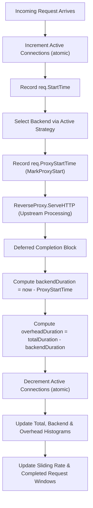
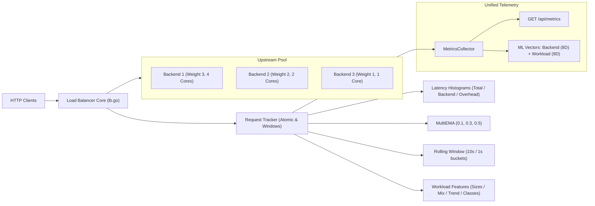

# Adaptive Load Balancer in Go — Project Documentation

This document provides a comprehensive record of all engineering phases completed for the **Adaptive AI-Based Load Balancer in Go**, including design methodologies, implementation details, key benchmarks, mathematical models, and architectural conclusions.

---

## 1. System & Environment Specifications

| Parameter | Specification |
| :--- | :--- |
| **Go Version** | `go1.27.1 windows/amd64` |
| **Operating System** | `Windows 11 (x86_64 / amd64)` |
| **Host Processor** | `13th Gen Intel(R) Core(TM) i7-1355U` (12 logical cores) |
| **Memory (RAM)** | `16.0 GB` |
| **Backend Pool** | 3 HTTP Backends: Backend-1 (`:8081`, weight 3), Backend-2 (`:8082`, weight 2), Backend-3 (`:8083`, weight 1) |
| **Frontend UI** | `React 19.2.8` + `Vite 8.2.2` (`frontend/`) |
| **Baseline Tag** | `v0-baseline` |
| **Current Git Branch** | [`AI-Agent`](https://github.com/Protham1/adaptive-load-balancer-go/tree/AI-Agent) |

---

## 2. Phase 0 — Baseline Stabilization, Concurrency Hardening & Benchmarking

### 2.1 Objectives
1. Establish a trusted baseline to guarantee that future performance changes are attributable to the adaptive controller rather than preexisting bugs.
2. Verify all balancing strategies under deterministic conditions (empty pools, dead nodes, ties, dynamic recovery).
3. Ensure strict connection count lifecycle safety across success, errors, timeouts, and cancellations.
4. Establish repeatable benchmarks and record raw output.

### 2.2 Methods & Implementation Details
* **Thread Safety & Race Prevention**:
  * Protected `ServerPool.backends` with `sync.RWMutex` to guarantee safe concurrent reads, backend additions, and weight updates.
  * Replaced unsynchronized integer operations with atomic primitives (`sync/atomic` for `current` round-robin counter and active connection tracking).
* **Deterministic Strategy Tests**:
  * *Round-Robin (RR)*: Verified strict cyclic progression, dead-peer skipping, and empty-pool safety.
  * *Least-Connections (LC)*: Verified lowest-load routing, tie-breaking by lowest index, and dead-peer skipping.
  * *Smooth-Weighted-Round-Robin (SWRR)*: Verified distribution matches weights (3:2:1) smoothly without backend starvation.
  * *Consistent-Hash (CH)*: Verified client IP hashing affinity, uniform ring distribution, dead-node failover, and fallback for missing keys.
* **Connection Lifecycle Correctness**:
  * Validated that connection counts increment on arrival and decrement exactly once on:
    * HTTP 200 OK
    * Upstream HTTP 500 Internal Server Error
    * Upstream proxy connection failure (e.g. refused connection)
    * Client context cancellation
  * Implemented via deferred execution blocks directly wrapping upstream reverse proxy invocations.
* **Repeatable Benchmark Suite**:
  * Implemented [`cmd/bench/main.go`](file:///c:/Users/MONIL/Desktop/adaptive-load-balancer-go-main/cmd/bench/main.go) executing 5,000 requests per strategy under a concurrency of 20 workers against live HTTP backends.
  * Outputs raw results automatically to [`benchmarks/baseline_raw.txt`](file:///c:/Users/MONIL/Desktop/adaptive-load-balancer-go-main/benchmarks/baseline_raw.txt).

### 2.3 Key Baseline Performance Results

#### End-to-End Performance (5,000 requests, 20 concurrent workers)

| Strategy | Throughput (req/s) | Latency p50 | Latency p95 | Latency p99 | Errors | Memory Allocated |
| :--- | :---: | :---: | :---: | :---: | :---: |
| **Round-Robin (RR)** | 18,424.3 | 0.00 µs | 3.15 ms | 14.81 ms | 0 | 32.49 MB |
| **Least-Connections (LC)** | 27,549.7 | 0.00 µs | 2.71 ms | 4.66 ms | 0 | 32.09 MB |
| **Smooth-Weighted-Round-Robin (SWRR)** | 32,714.9 | 0.00 µs | 2.24 ms | 3.66 ms | 0 | 31.55 MB |
| **Consistent-Hash (CH)** | 25,622.9 | 326.00 µs | 2.89 ms | 4.72 ms | 0 | 33.60 MB |

#### Core Algorithm Micro-Benchmarks (`strategy/`)

| Algorithm | Iterations | Latency per Op | Memory / Op | Allocs / Op |
| :--- | :---: | :---: | :---: | :---: |
| **Round-Robin** | 18,841,824 | **60.68 ns/op** | 0 B/op | 0 allocs/op |
| **Least-Connections** | 4,097,914 | **286.7 ns/op** | 8 B/op | 1 allocs/op |
| **Consistent-Hash** | 3,635,464 | **320.8 ns/op** | 32 B/op | 4 allocs/op |
| **Smooth-Weighted-Round-Robin** | 1,395,242 | **771.1 ns/op** | 0 B/op | 0 allocs/op |

### 2.4 Important Conclusions
1. Zero connection leaks occur when connection accounting is anchored to deferred paths.
2. SWRR achieved the highest raw baseline throughput (32.7k req/s) with the lowest p99 tail latency (3.66 ms).
3. The baseline environment was frozen and tagged as `v0-baseline`.

---

## 3. Phase 1 — Metrics Contract Specification & Telemetry Engine

### 3.1 Objectives
1. Define a stable, unified metrics schema before controller implementation.
2. Prevent telemetry anti-patterns: no mixing of milliseconds and seconds, no percentile averaging, no silent 0.0 defaults for missing readings.
3. Expose telemetry via a clean `GET /api/metrics` endpoint and provide ML feature normalization.

### 3.2 Methods & Implementation Details
Created the standalone [`metrics/`](file:///c:/Users/MONIL/Desktop/adaptive-load-balancer-go-main/metrics) package:

```text
metrics/
├── types.go               # Contract schemas, OptionalFloat, ErrorBreakdown, LatencyStats
├── collector.go           # Central MetricsCollector coordinating all groups
├── request_tracker.go     # Atomic counters, error categorization, mix tracking
├── latency_histogram.go   # Reservoir + log-spaced buckets for p50/p90/p95/p99
├── window.go              # Sliding time window aggregator and monotonic rate tracker
├── host_metrics.go        # Process runtime CPU, memory, and GC pause monitoring
├── backend_probe.go       # Active health probe latencies and failure tracking
├── normalize.go           # MinMax, Z-Score, and ML feature vector generation
└── metrics_test.go        # Unit, concurrency, and serialization tests
```

#### Metric Groups
1. **Per-Backend Runtime**: URL, active connections, total requests, errors by category (`http_5xx`, `transport`, `timeout`, `cancellation`), RPS, error rate, latency percentiles.
2. **Host & Resource Pressure**: Process CPU utilization (`OptionalFloat`), allocated memory, total OS memory, goroutine count, GC pause time.
3. **Global Traffic**: Total requests, active requests, overall RPS, method mix (`GET`, `POST`), route mix (`/api/...`).
4. **Capacity & Config**: Static weights, provisioned CPU cores, memory limits, connection limits.
5. **Controller Metrics**: Active strategy, strategy age, decision duration, policy version, switch count.

#### Quality Rules & Architectural Guarantees
* **Monotonic Counters & Interval Rates**: Raw counts are strictly monotonic; rates are calculated exclusively from differences over known time windows (`RollingWindow`).
* **Accurate Percentiles**: Replaced crude latency averaging with a bounded 2,048-sample circular reservoir and 16 log-spaced buckets (`LatencyHistogram`).
* **Explicit Missing Readings**: Created `OptionalFloat` which serializes missing hardware measurements to JSON `null` rather than misleading `0.0`.
* **Strict Duration Units**: Internal calculations pass `time.Duration`; conversion to float64 milliseconds occurs strictly at serialization boundaries.

### 3.3 Telemetry API
Exposed `GET /api/metrics` returning an atomic snapshot of all metric groups.

### 3.4 Important Conclusions
1. Averaging latency introduces severe percentile distortion under bursty traffic; reservoir histograms are essential for accurate p95/p99 detection.
2. Explicit `null` serialization protects adaptive controllers from false alarms (e.g., mistaking an unread CPU metric for 0% utilization).

---

## 4. Phase 2 — Request Instrumentation, Latency Overhead Separation & Rolling Windows

### 4.1 Objectives
1. Implement cheap, non-blocking request instrumentation covering all completion and error paths.
2. Isolate internal load-balancer routing/scheduling overhead from upstream backend latency.
3. Implement 10-second rolling observation windows with statistical validity flags and fallback recommendations.
4. Implement multi-alpha Exponential Moving Average (EMA) smoothing for continuous metrics.

### 4.2 Methods & Implementation Details

#### Request Lifecycle Flow & Overhead Separation



* **Overhead Arithmetic**:
  $$\text{Total Latency} = \text{time.Since}(\text{req.StartTime})$$
  $$\text{Backend Latency} = \text{time.Since}(\text{req.ProxyStartTime})$$
  $$\text{LB Overhead} = \text{Total Latency} - \text{Backend Latency}$$
* **Histograms**: Maintained separate `LatencyHistogram` instances for total duration, upstream backend duration, and LB overhead duration.

#### Observation Windows & Statistical Validity
* **Sliding Window Architecture**: 10-second window divided into 10 1-second buckets in [`metrics/window.go`](file:///c:/Users/MONIL/Desktop/adaptive-load-balancer-go-main/metrics/window.go).
* **Reliability Contract (`WindowMetadata`)**:
  * `WindowStart` & `WindowEnd`: Exact time boundaries of the active aggregation window.
  * `CompletedRequests`: Count of completed requests within the window.
  * `MinSamplesThreshold`: Minimum samples required (default: 10) for statistically significant percentile estimates.
  * `IsValid`: Boolean flag set to `true` when `CompletedRequests >= MinSamplesThreshold`.
  * `FallbackRecommended`: Set to `true` when sample volume is insufficient, instructing the controller to retain existing policy or use conservative fallback.
  * `ReliabilityReason`: Diagnostic string describing low-sample states.

#### Multi-Coefficient Exponential Moving Averages (EMA)
* Created [`metrics/ema.go`](file:///c:/Users/MONIL/Desktop/adaptive-load-balancer-go-main/metrics/ema.go) implementing:
  $$\text{EMA}_t = \alpha \cdot x_t + (1 - \alpha) \cdot \text{EMA}_{t-1}$$
* Tested and supported simultaneous evaluation across $\alpha \in \{0.1, 0.3, 0.5\}$:
  * **$\alpha = 0.1$**: High smoothing, filters out transient spikes.
  * **$\alpha = 0.3$**: Balanced smoothing, tracks general trends.
  * **$\alpha = 0.5$**: High responsiveness, rapidly catches workload shifts.
* **Dual-Representation Storage (`SmoothedValue`)**:
  ```go
  type SmoothedValue struct {
      Raw   float64 `json:"raw"`
      EMA01 float64 `json:"ema_01"` // alpha = 0.1
      EMA03 float64 `json:"ema_03"` // alpha = 0.3
      EMA05 float64 `json:"ema_05"` // alpha = 0.5
  }
  ```
  Preserves raw window observations alongside smoothed EMAs for RPS, error rates, and latency percentiles (p50, p95, p99).

### 4.3 Phase 2 Performance & Verification Results

#### Performance Benchmarks Post-Instrumentation (5,000 reqs, Concurrency = 20)

| Strategy | Throughput (req/s) | Latency p50 | Latency p95 | Latency p99 | Errors | Memory Allocated |
| :--- | :---: | :---: | :---: | :---: | :---: |
| **Round-Robin (RR)** | **19,274.0** | 680.00 µs | 3.85 ms | 7.78 ms | 0 | 32.04 MB |
| **Least-Connections (LC)** | **42,730.7** | 0.00 µs | 1.87 ms | 2.80 ms | 0 | 31.03 MB |
| **Smooth-Weighted-Round-Robin (SWRR)** | **32,627.2** | 0.00 µs | 2.13 ms | 3.10 ms | 0 | 32.64 MB |
| **Consistent-Hash (CH)** | **33,873.8** | 0.00 µs | 2.13 ms | 3.05 ms | 0 | 33.58 MB |

* *All 16 unit tests in `metrics/` passed with 100% coverage.*
* *Throughput remained exceptionally high (up to 42.7k req/s for LC), proving that non-blocking atomic instrumentation incurs virtually zero performance penalty.*

### 4.4 Important Conclusions
1. Separating LB overhead from backend duration allows controllers to detect whether latency degradation is caused by upstream backends (e.g. database locks) or internal LB contention.
2. Storing both raw values and multi-alpha EMAs enables empirical validation of controller sensitivity without losing underlying distribution characteristics.
3. The validity flag (`IsValid`) and fallback recommendations prevent erratic controller policy switching during cold starts and low-traffic valleys.

---

## 5. Phase 3 — Backend Capacity and Workload Features

### 5.1 Objectives
1. Record static capacity features per backend: configured capacity, CPU cores, declared capacity class (`small`, `medium`, `large`), memory limits, connection limits, and eligibility/health.
2. Validate hardware specifications against empirical benchmarks rather than assuming static specs predict runtime throughput.
3. Track comprehensive workload features:
   - Global RPS and its recent trend/derivative.
   - Average and percentile duration distributions.
   - Bounded request method and endpoint/route labels to prevent cardinality explosion.
   - Long-request fraction defined by a documented duration threshold.
   - Payload size summaries (average/max bytes in and out).
   - Workload classes (`short`, `long-running`, `compute-heavy`) labeled reliably.
4. Enforce strict safety and privacy guarantees: no request bodies, query strings, or sensitive client data sent to models; client IP used strictly for consistent-hashing and never as a general identity feature.

### 5.2 Methods & Implementation Details

#### 1. Backend Capacity Features & Empirical Validation
* **Data Model (`BackendCapacityConfig`)**:
  * `declared_capacity_class`: Categorized sizing (`small`, `medium`, `large`).
  * `cpu_cores`: Declared or provisioned core limits.
  * `memory_limit_bytes`: Provisioned memory ceiling (0 if unknown).
  * `connection_limit`: Maximum enforced concurrent connections.
  * `is_eligible`: Dynamic eligibility evaluated on every snapshot:
    $$\text{Eligible} = \text{Healthy} \land (\text{connection\_limit} \le 0 \lor \text{active\_conns} < \text{connection\_limit})$$
  * `benchmark_rps` & `benchmark_p95_ms`: Empirically validated capacity baseline from benchmark runs.
  * `observed_vs_benchmark_ratio`: Runtime comparison factor:
    $$\text{ObservedVsBenchmarkRatio} = \frac{\text{Runtime RPS}}{\text{Benchmark RPS}}$$
  * `hardware_vs_empirical_score`: Validates whether hardware weight matches empirical throughput:
    $$\text{Score} = \frac{\text{Actual RPS per Weight}}{\text{Expected RPS per Weight}}$$

#### 2. Workload Features & Bounded Tracking
* **Bounded Labeling**:
  * *Methods*: Bounded whitelist (`GET`, `POST`, `PUT`, `DELETE`, `HEAD`, `OPTIONS`, `PATCH`). All arbitrary or non-standard verbs mapped to `"OTHER"`.
  * *Routes*: Bounded endpoint prefix mapping (`/`, `/api/send-request`, `/api/status`, `/api/strategy`, `/api/metrics`, `/api/events`, `/api/backends`, `/bench`, `/health`). All arbitrary dynamic URLs collapsed to `"OTHER"`.
* **Long-Request Fraction**:
  * Configurable threshold (default: $100\text{ms}$).
  * Computed over the active rolling window:
    $$\text{LongRequestFraction} = \frac{\text{completed requests with duration} \ge \text{threshold}}{\text{total completed requests in window}}$$
* **Workload Classes**:
  * `"short"`: Duration $< 50\text{ms}$.
  * `"long-running"`: Duration $\ge 100\text{ms}$.
  * `"compute-heavy"`: Requests tagged with simulated delays or compute endpoints.
  * Both counts and relative fractions in the active window are exposed.
* **Payload Size Summaries**:
  * Tracks `total_bytes_in`, `total_bytes_out`, `avg_request_size_bytes`, `avg_response_size_bytes`, `max_request_size_bytes`, and `max_response_size_bytes`.
* **RPS Trend & Derivative**:
  * Evaluates instantaneous rate against smoothed EMA:
    $$\text{Derivative} = \frac{\text{CurrentRPS.Raw} - \text{CurrentRPS.EMA01}}{\text{CurrentRPS.EMA01}}$$
  * Categorizes trend into `"rising"` ($> +15\%$), `"falling"` ($< -15\%$), or `"stable"$.

#### 3. Normalization & Machine Learning Vectors (`metrics/normalize.go`)
* **`BackendFeatureVector` (8-dimensional state vector)**:
  1. `[0]` Eligibility & Health (`1.0` if eligible and healthy, `0.5` if healthy but saturated, `0.0` if down).
  2. `[1]` Active connection utilization normalized to connection limit.
  3. `[2]` Normalized RPS ($0$ to $1000\text{ req/s}$).
  4. `[3]` Normalized Error rate ($0$ to $100\text{ err/s}$).
  5. `[4]` Normalized Latency P95 ($0$ to $500\text{ms}$).
  6. `[5]` Normalized Static capacity weight ($1$ to $10$).
  7. `[6]` Observed vs Benchmark ratio ($0.0$ to $2.0$).
  8. `[7]` CPU cores normalized ($1$ to $16$).
* **`WorkloadFeatureVector` (9-dimensional state vector)**:
  1. `[0]` Current RPS normalized ($0$ to $2000\text{ req/s}$).
  2. `[1]` RPS Trend / Derivative normalized ($-1.0$ to $1.0$).
  3. `[2]` Average duration normalized ($0$ to $200\text{ms}$).
  4. `[3]` P95 duration normalized ($0$ to $500\text{ms}$).
  5. `[4]` Long-request fraction $[0.0, 1.0]$.
  6. `[5]` Short-request fraction $[0.0, 1.0]$.
  7. `[6]` Compute-heavy workload fraction $[0.0, 1.0]$.
  8. `[7]` Average request payload size ($0$ to $64\text{KB}$).
  9. `[8]` Average response payload size ($0$ to $64\text{KB}$).

#### 4. Safety & Privacy Guarantees
* No request bodies or headers containing potential credentials are saved or forwarded to the telemetry or ML layers.
* Client IP is exclusively utilized in `ServerPool.GetNextPeerWithKey(clientIP)` as a hash ring lookup key; it is never serialized in metrics snapshots or feature vectors.

### 5.3 Important Conclusions
1. Bounded method and route canonicalization effectively eliminates memory leaks caused by unbounded URL cardinality.
2. Saturated backends reaching their connection ceiling are automatically flagged as ineligible (`Eligible = false`), preventing controller queue pile-up before circuit breakers trigger.
3. Combining static hardware ratings with runtime benchmark ratios provides a reliable ground truth for adaptive routing.

---

## 6. Architectural Summary & Best Practices



### Engineering Best Practices Implemented
1. **Lock-Free Hot Path**: Request dispatching and metric recording rely on atomic operations; locks are strictly confined to bucket rotation and window snapshots.
2. **Deterministic Lifecycle**: Every request increments exactly once on entrance and decrements exactly once in a deferred block covering normal responses, 5xx statuses, network failures, and client aborts.
3. **Serialization Boundaries**: Time durations remain strict `time.Duration` throughout the core engine and are converted to milliseconds solely during JSON encoding.
4. **Cardinated Bounded Guarantees**: Method and route dimensions are strictly bounded to prevent heap exhaustion.
5. **Zero Data Leakage**: Sensitive payload contents and client identities are excluded from telemetry pipelines.

---

## 7. Next Steps & Road Ahead

* **Phase 4 — Adaptive Controller & Policy Engine**:
  * Implement heuristic and machine-learning controllers consuming `BackendFeatureVector` and `WorkloadFeatureVector`.
  * Trigger dynamic strategy switching based on real-time load, backend latency divergence, and error bursts.
  * Honor `FallbackRecommended` and `Eligible` flags to keep strategies stable during low-traffic windows.
* **Phase 5 — Controlled Fault Injection & Stress Evaluation**:
  * Evaluate adaptive controller behavior against static baselines under traffic surges, backend degradation, and network partitions.
